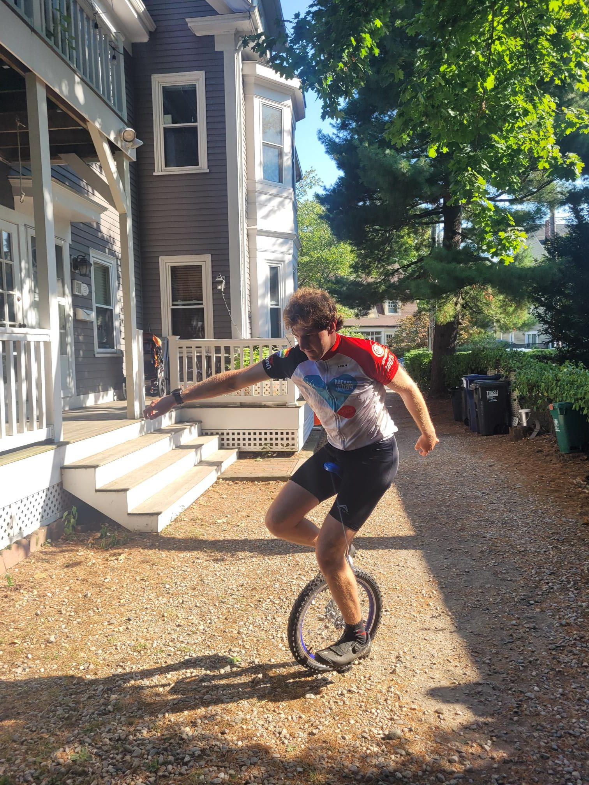

+++
title = "Unicyclocross?"
description = "Ride — 2024-09-17"
date = 2024-09-17
authors = ["Max Katz-Christy"]

[taxonomies]
tags = ["Ride"]

[extra]
banner = "banner.jpg"
strava_id = 12433546194
distance_fmt = "28.20 km"
moving_time_fmt = "1h 58m 32s"
elevation_gain_fmt = "155 m"
+++

Got to danehy too early so I took a lap around fresh pond. Saw a goose at staples... Maybe there's a back to the dock sale. Stopped at my parents on the way home and did my first ever (I think) standing start on a unicycle!
PS: also did some CX practice with Coach and Tatem Rios and Chen Lu 
Apparently I don't follow Nick...

## Stats

| | |
|---|---|
| **Distance** | 28.20 km |
| **Moving time** | 1h 58m 32s |
| **Elapsed time** | 3h 25m 36s |
| **Elevation gain** | 155 m |
| **Average speed** | 14.3 km/h |
| **Max speed** | 39.0 km/h |
| **Calories** | 1049 kcal |
| **Achievements** | 9 |
| **Device** | Garmin fēnix 6X |

## Route

{{ strava_map() }}

[View on Strava](https://www.strava.com/activities/12433546194)

## Photos

