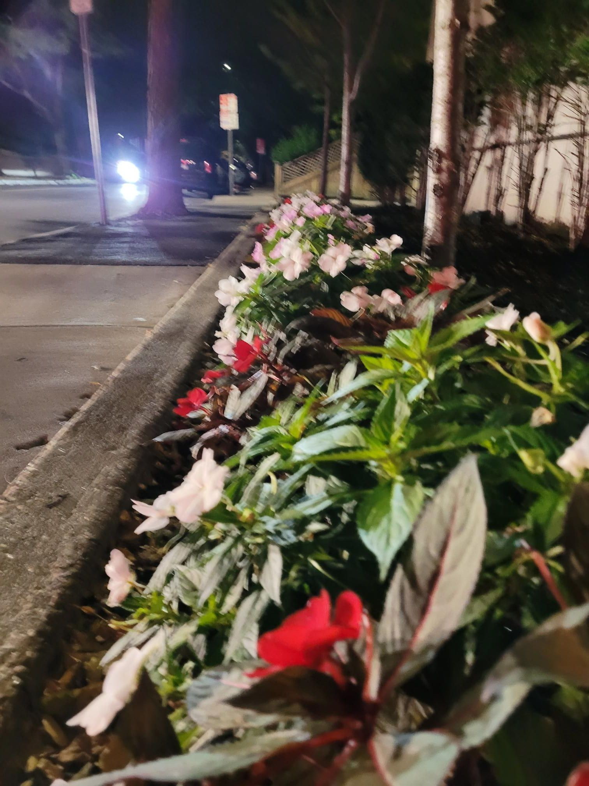

+++
title = "Apple Crisp is the my favorite food"
description = "Run — 2024-10-12"
date = 2024-10-12
authors = ["Max Katz-Christy"]

[taxonomies]
tags = ["Run"]

[extra]
banner = "banner.jpg"
strava_id = 12641637609
distance_fmt = "3.98 km"
moving_time_fmt = "22m 46s"
elevation_gain_fmt = "16 m"
+++

i never know how to answer that question, but i think this is it

## Stats

| | |
|---|---|
| **Distance** | 3.98 km |
| **Moving time** | 22m 46s |
| **Elapsed time** | 23m 30s |
| **Elevation gain** | 16 m |
| **Average pace** | 5:43 /km |
| **Best pace** | 3:42 /km |
| **Average cadence** | 78 rpm |
| **Calories** | 279 kcal |
| **Device** | Garmin fēnix 6X |

## Route

{{ strava_map() }}

[View on Strava](https://www.strava.com/activities/12641637609)

## Photos

