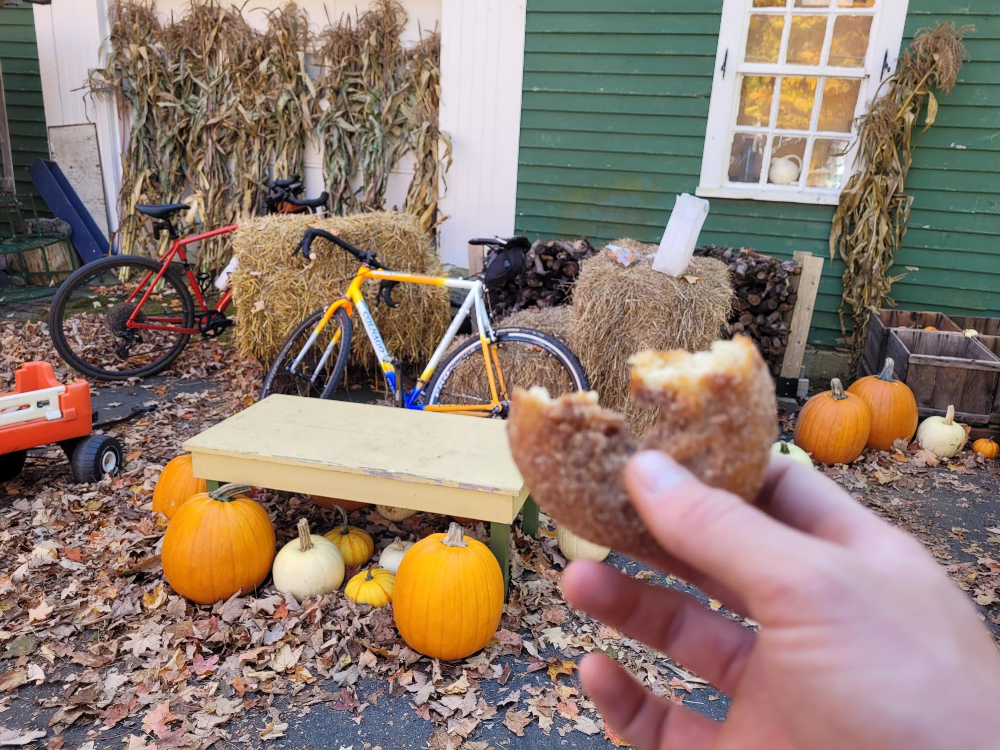

+++
title = "10.6 MPD (miles per donut)"
description = "Ride — 2024-10-19"
date = 2024-10-19
authors = ["Max Katz-Christy"]

[taxonomies]
tags = ["Ride"]

[extra]
banner = "banner.jpg"
strava_id = 12695892276
distance_fmt = "119.71 km"
moving_time_fmt = "6h 21m 44s"
elevation_gain_fmt = "870 m"
+++

I also had a carrot and a medium sized tomato. And an apple. And some apple crisp at the end. And a taste of risotto.

Started off with Jackson Moore-Otto and ended with the MIT MTB boomer crew (Hannah Varner Matthew Goss Felix Knollmann & co)

## Stats

| | |
|---|---|
| **Distance** | 119.71 km |
| **Moving time** | 6h 21m 44s |
| **Elapsed time** | 8h 16m 02s |
| **Elevation gain** | 870 m |
| **Average speed** | 18.8 km/h |
| **Max speed** | 48.6 km/h |
| **Calories** | 2953 kcal |
| **Achievements** | 55 |
| **Device** | Garmin fēnix 6X |

## Route

{{ strava_map() }}

[View on Strava](https://www.strava.com/activities/12695892276)

## Photos

