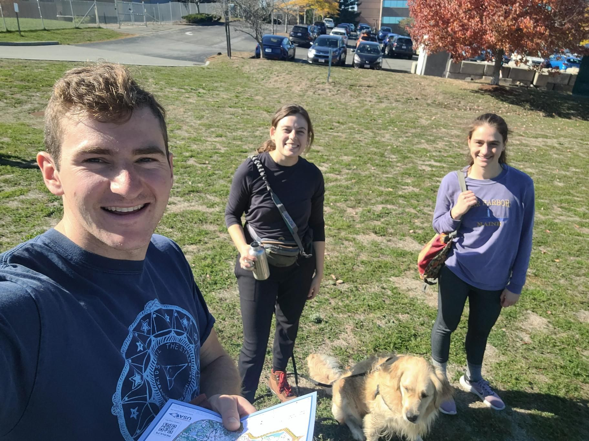

+++
title = "Looking at map + trail running = rolled ankle"
description = "TrailRun — 2024-10-20"
date = 2024-10-20
authors = ["Max Katz-Christy"]

[taxonomies]
tags = ["TrailRun"]

[extra]
banner = "banner.jpg"
strava_id = 12703656609
distance_fmt = "6.10 km"
moving_time_fmt = "1h 01m 21s"
elevation_gain_fmt = "154 m"
+++

orienteering is awesome and i want to do more!

## Stats

| | |
|---|---|
| **Distance** | 6.10 km |
| **Moving time** | 1h 01m 21s |
| **Elapsed time** | 1h 19m 08s |
| **Elevation gain** | 154 m |
| **Average pace** | 10:03 /km |
| **Best pace** | 3:38 /km |
| **Average cadence** | 57 rpm |
| **Calories** | 540 kcal |
| **Device** | Garmin fēnix 6X |

## Route

{{ strava_map() }}

[View on Strava](https://www.strava.com/activities/12703656609)

## Photos

