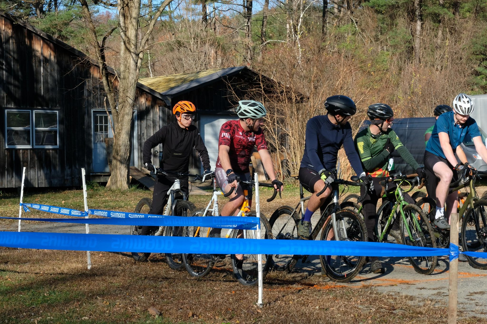

+++
title = "I might try singlespeed later..."
description = "Ride — 2024-11-03"
date = 2024-11-03
authors = ["Max Katz-Christy"]

[taxonomies]
tags = ["Ride"]

[extra]
banner = "banner.jpg"
strava_id = 12814219469
distance_fmt = "14.63 km"
moving_time_fmt = "44m 42s"
elevation_gain_fmt = "177 m"
+++

Got my first cx podium! Super frosty morning, but it's sunny now!

Photo creds Cami and Nick Arango

## Stats

| | |
|---|---|
| **Distance** | 14.63 km |
| **Moving time** | 44m 42s |
| **Elapsed time** | 46m 37s |
| **Elevation gain** | 177 m |
| **Average speed** | 19.6 km/h |
| **Max speed** | 37.3 km/h |
| **Calories** | 285 kcal |
| **Achievements** | 11 |
| **Device** | Garmin fēnix 6X |

## Route

{{ strava_map() }}

[View on Strava](https://www.strava.com/activities/12814219469)

## Photos

