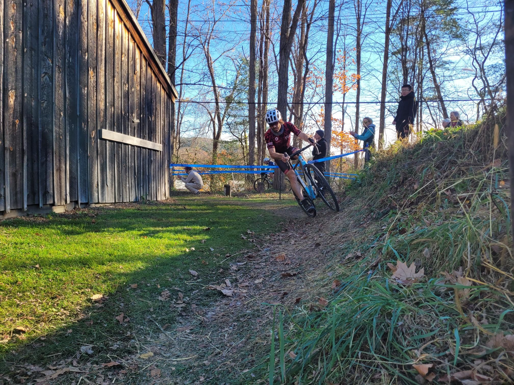

+++
title = "Somehow I'm faster with no shifting"
description = "Ride — 2024-11-03"
date = 2024-11-03
authors = ["Max Katz-Christy"]

[taxonomies]
tags = ["Ride"]

[extra]
banner = "banner.jpg"
strava_id = 12816647148
distance_fmt = "17.41 km"
moving_time_fmt = "50m 44s"
elevation_gain_fmt = "188 m"
+++

including crashes and mechanicals

i don't have any pics of my race so here is nick

## Stats

| | |
|---|---|
| **Distance** | 17.41 km |
| **Moving time** | 50m 44s |
| **Elapsed time** | 50m 44s |
| **Elevation gain** | 188 m |
| **Average speed** | 20.6 km/h |
| **Max speed** | 39.4 km/h |
| **Calories** | 539 kcal |
| **Achievements** | 11 |
| **Device** | Garmin fēnix 6X |

## Route

{{ strava_map() }}

[View on Strava](https://www.strava.com/activities/12816647148)

## Photos

