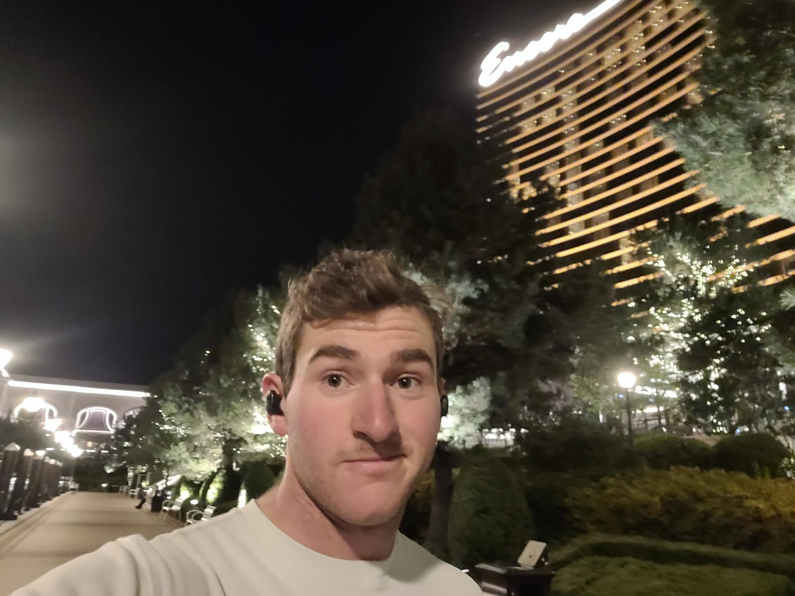

+++
title = "Incestual Sailing Knowledge"
description = "Run — 2024-11-16"
date = 2024-11-16
authors = ["Max Katz-Christy"]

[taxonomies]
tags = ["Run"]

[extra]
banner = "banner.jpg"
strava_id = 12918534258
distance_fmt = "16.60 km"
moving_time_fmt = "2h 05m 42s"
elevation_gain_fmt = "82 m"
+++

i learned to pitch a softball today. very exciting. if anyone has any sports i should try lmk. also if you tell me, you should run to encore, i will run to encore

## Stats

| | |
|---|---|
| **Distance** | 16.60 km |
| **Moving time** | 2h 05m 42s |
| **Elapsed time** | 3h 02m 19s |
| **Elevation gain** | 82 m |
| **Average pace** | 7:34 /km |
| **Best pace** | 3:01 /km |
| **Average cadence** | 76 rpm |
| **Calories** | 1207 kcal |
| **Achievements** | 1 |
| **Device** | Garmin fēnix 6X |

## Route

{{ strava_map() }}

[View on Strava](https://www.strava.com/activities/12918534258)

## Photos

