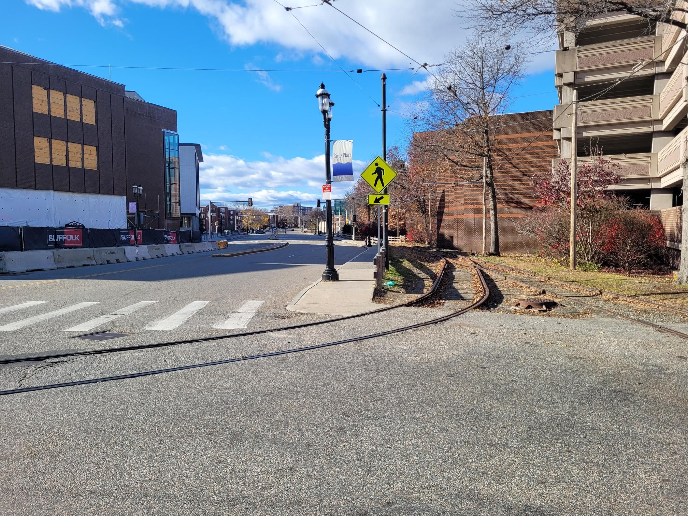

+++
title = "Cooldown with Seamus"
description = "Ride — 2024-11-24"
date = 2024-11-24
authors = ["Max Katz-Christy"]

[taxonomies]
tags = ["Ride"]

[extra]
banner = "banner.jpg"
strava_id = 12974941646
distance_fmt = "8.25 km"
moving_time_fmt = "30m 01s"
elevation_gain_fmt = "124 m"
+++

who knew trolleys could turn that tight? also my dad has a fun new scooter

## Stats

| | |
|---|---|
| **Distance** | 8.25 km |
| **Moving time** | 30m 01s |
| **Elapsed time** | 32m 52s |
| **Elevation gain** | 124 m |
| **Average speed** | 16.5 km/h |
| **Max speed** | 38.5 km/h |
| **Calories** | 239 kcal |
| **Device** | Garmin fēnix 6X |

## Route

{{ strava_map() }}

[View on Strava](https://www.strava.com/activities/12974941646)

## Photos

