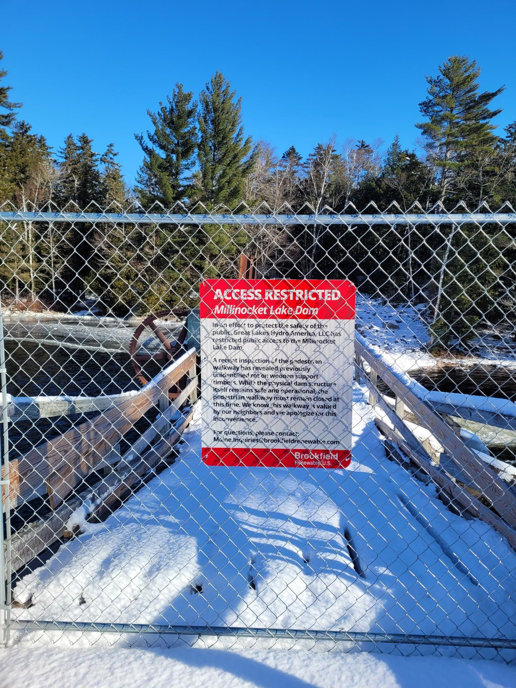

+++
title = "Millinocket Snowmobile Trail Half Sketchathon++"
description = "TrailRun — 2024-12-07"
date = 2024-12-07
authors = ["Max Katz-Christy"]

[taxonomies]
tags = ["TrailRun"]

[extra]
banner = "banner.jpg"
strava_id = 13066817839
distance_fmt = "24.32 km"
moving_time_fmt = "2h 38m 21s"
elevation_gain_fmt = "348 m"
+++

I'm an idiot and forgot to hit submit on my registration. Absolutely beautiful trails though. Sometimes idiocy pays off

## Stats

| | |
|---|---|
| **Distance** | 24.32 km |
| **Moving time** | 2h 38m 21s |
| **Elapsed time** | 2h 51m 26s |
| **Elevation gain** | 348 m |
| **Average pace** | 6:30 /km |
| **Best pace** | 3:53 /km |
| **Average cadence** | 78 rpm |
| **Calories** | 1880 kcal |
| **Device** | Garmin fēnix 6X |

## Route

{{ strava_map() }}

[View on Strava](https://www.strava.com/activities/13066817839)

## Photos

