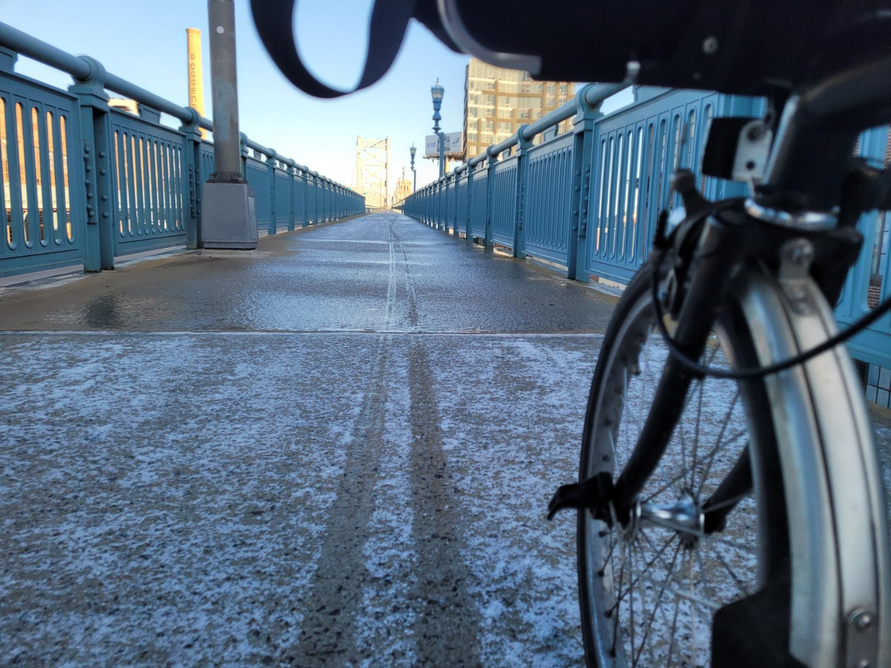

+++
title = "Slip and slide over the bridge to the River Line"
description = "Ride — 2024-12-21"
date = 2024-12-21
authors = ["Max Katz-Christy"]

[taxonomies]
tags = ["Ride"]

[extra]
banner = "banner.jpg"
strava_id = 13164246004
distance_fmt = "5.41 km"
moving_time_fmt = "40m 17s"
elevation_gain_fmt = "73 m"
+++

Taking the fun route to NYC

Also some fun bromton pics and a sam cannon

## Stats

| | |
|---|---|
| **Distance** | 5.41 km |
| **Moving time** | 40m 17s |
| **Elapsed time** | 42m 44s |
| **Elevation gain** | 73 m |
| **Average speed** | 8.1 km/h |
| **Max speed** | 29.8 km/h |
| **Calories** | 318 kcal |
| **Device** | Garmin fēnix 6X |

## Route

{{ strava_map() }}

[View on Strava](https://www.strava.com/activities/13164246004)

## Photos

