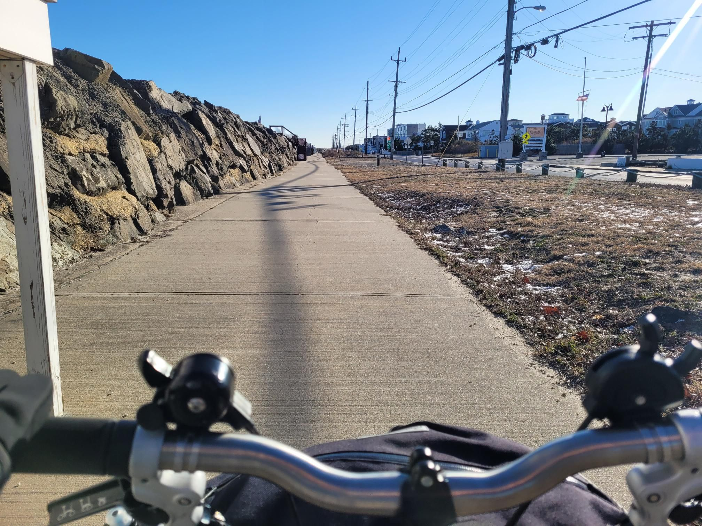

+++
title = "Brooklyn -> Brooke 2.75h by bromton + boat"
description = "Ride — 2024-12-22"
date = 2024-12-22
authors = ["Max Katz-Christy"]

[taxonomies]
tags = ["Ride"]

[extra]
banner = "banner.jpg"
strava_id = 13170474170
distance_fmt = "11.83 km"
moving_time_fmt = "33m 12s"
elevation_gain_fmt = "58 m"
+++

not too bad, I'm curious how it compares to train

## Stats

| | |
|---|---|
| **Distance** | 11.83 km |
| **Moving time** | 33m 12s |
| **Elapsed time** | 33m 50s |
| **Elevation gain** | 58 m |
| **Average speed** | 21.4 km/h |
| **Max speed** | 37.9 km/h |
| **Calories** | 248 kcal |
| **Device** | Garmin fēnix 6X |

## Route

{{ strava_map() }}

[View on Strava](https://www.strava.com/activities/13170474170)

## Photos

