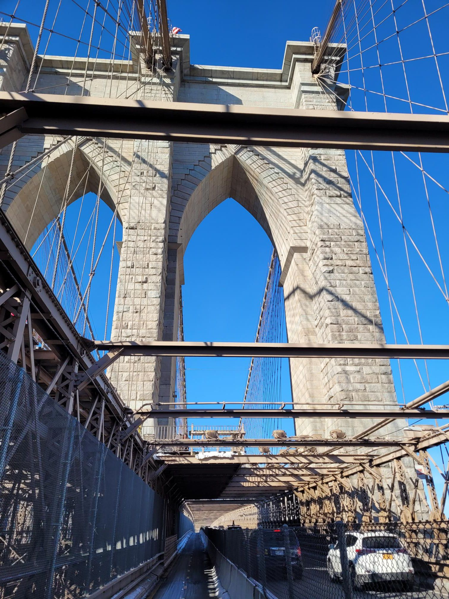

+++
title = "Why is everyone walking over the Brooklyn bridge? Don't they know it's cold out?"
description = "Ride — 2024-12-22"
date = 2024-12-22
authors = ["Max Katz-Christy"]

[taxonomies]
tags = ["Ride"]

[extra]
banner = "banner.jpg"
strava_id = 13169901948
distance_fmt = "9.50 km"
moving_time_fmt = "32m 34s"
elevation_gain_fmt = "91 m"
+++

also the ferry man selling tickets has such a low key operation

## Stats

| | |
|---|---|
| **Distance** | 9.50 km |
| **Moving time** | 32m 34s |
| **Elapsed time** | 35m 02s |
| **Elevation gain** | 91 m |
| **Average speed** | 17.5 km/h |
| **Max speed** | 49.1 km/h |
| **Calories** | 192 kcal |
| **Device** | Garmin fēnix 6X |

## Route

{{ strava_map() }}

[View on Strava](https://www.strava.com/activities/13169901948)

## Photos

