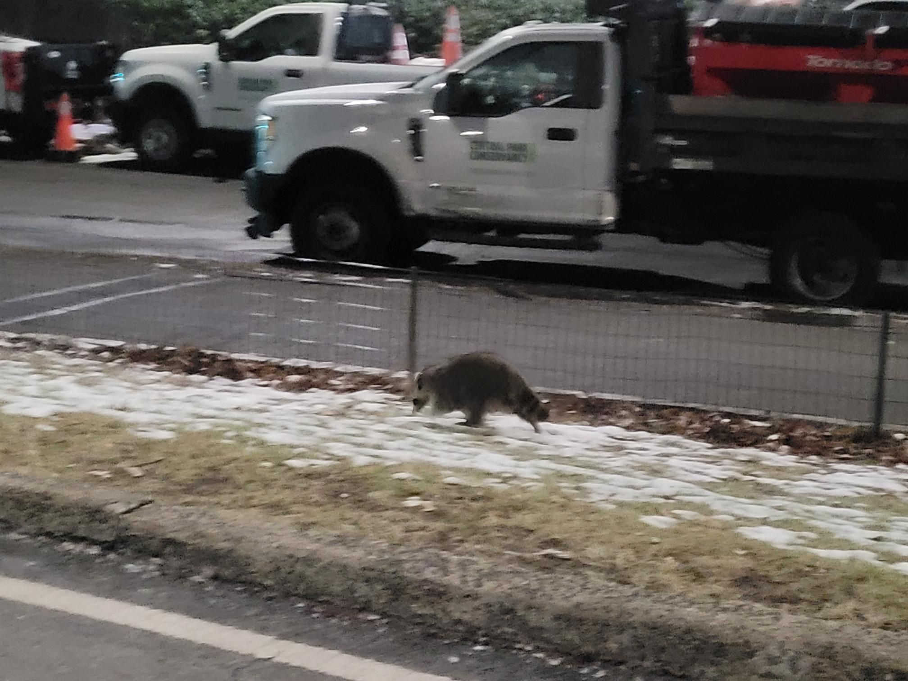

+++
title = "Amtrak delay Central Park reverse lap"
description = "Ride — 2024-12-27"
date = 2024-12-27
authors = ["Max Katz-Christy"]

[taxonomies]
tags = ["Ride"]

[extra]
banner = "banner.jpg"
strava_id = 13204837846
distance_fmt = "14.88 km"
moving_time_fmt = "57m 27s"
elevation_gain_fmt = "132 m"
+++

but officer, i was only going one way! 

lmk if I should add you to my last minute NYC list so next time I'm accidentally in NYC I'll ping you too

scroll all the way to the end for a Bernie meme

## Stats

| | |
|---|---|
| **Distance** | 14.88 km |
| **Moving time** | 57m 27s |
| **Elapsed time** | 1h 01m 19s |
| **Elevation gain** | 132 m |
| **Average speed** | 15.5 km/h |
| **Max speed** | 37.5 km/h |
| **Calories** | 367 kcal |
| **Device** | Garmin fēnix 6X |

## Route

{{ strava_map() }}

[View on Strava](https://www.strava.com/activities/13204837846)

## Photos

