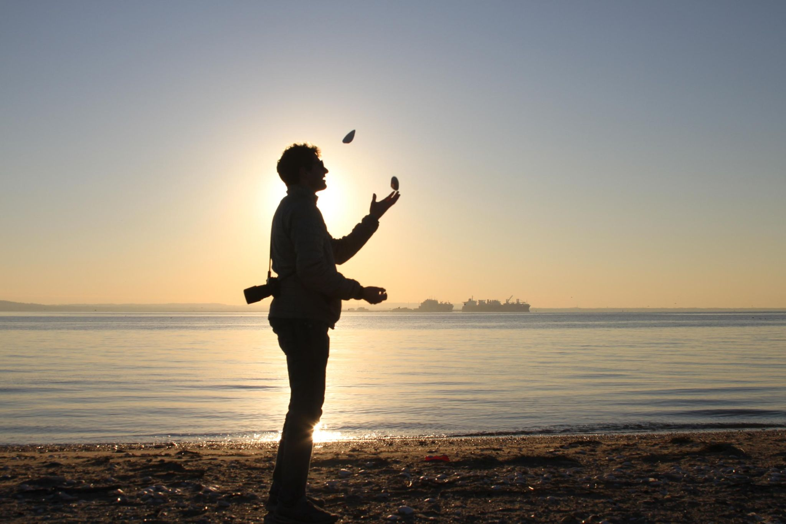

+++
title = "Back to Boston by train"
description = "Ride — 2024-12-27"
date = 2024-12-27
authors = ["Max Katz-Christy"]

[taxonomies]
tags = ["Ride"]

[extra]
banner = "banner.jpg"
strava_id = 13204180034
distance_fmt = "7.32 km"
moving_time_fmt = "22m 31s"
elevation_gain_fmt = "44 m"
+++

went past the bat hotel

also, silhouettes are fun

## Stats

| | |
|---|---|
| **Distance** | 7.32 km |
| **Moving time** | 22m 31s |
| **Elapsed time** | 22m 31s |
| **Elevation gain** | 44 m |
| **Average speed** | 19.5 km/h |
| **Max speed** | 27.3 km/h |
| **Calories** | 216 kcal |
| **Device** | Garmin fēnix 6X |

## Route

{{ strava_map() }}

[View on Strava](https://www.strava.com/activities/13204180034)

## Photos

