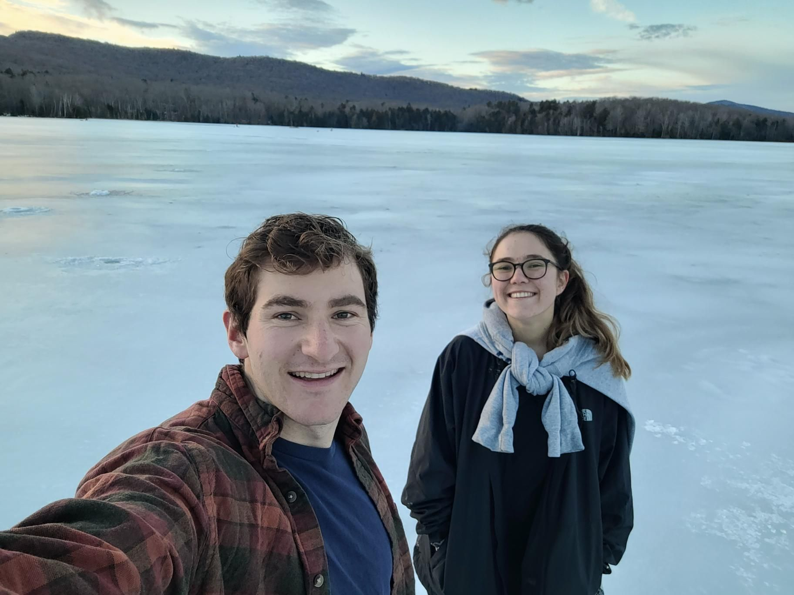

+++
title = "I shoulda brought my skates 😥"
description = "Hike — 2024-12-31"
date = 2024-12-31
authors = ["Max Katz-Christy"]

[taxonomies]
tags = ["Hike"]

[extra]
banner = "banner.jpg"
strava_id = 13234685383
distance_fmt = "4.80 km"
moving_time_fmt = "1h 26m 50s"
elevation_gain_fmt = "212 m"
+++

that said it's still a bit sketchy

went to Maine, back to Boston, then out to Western ma and up to vt.

Springfield is very interesting! home of the dr seuss museum, candlepin bowling (nearby), and the basketball ball of fame

## Stats

| | |
|---|---|
| **Distance** | 4.80 km |
| **Moving time** | 1h 26m 50s |
| **Elapsed time** | 1h 52m 06s |
| **Elevation gain** | 212 m |
| **Average pace** | 18:05 /km |
| **Best pace** | 7:30 /km |
| **Average cadence** | 53 rpm |
| **Calories** | 485 kcal |
| **Device** | Garmin fēnix 6X |

## Route

{{ strava_map() }}

[View on Strava](https://www.strava.com/activities/13234685383)

## Photos

