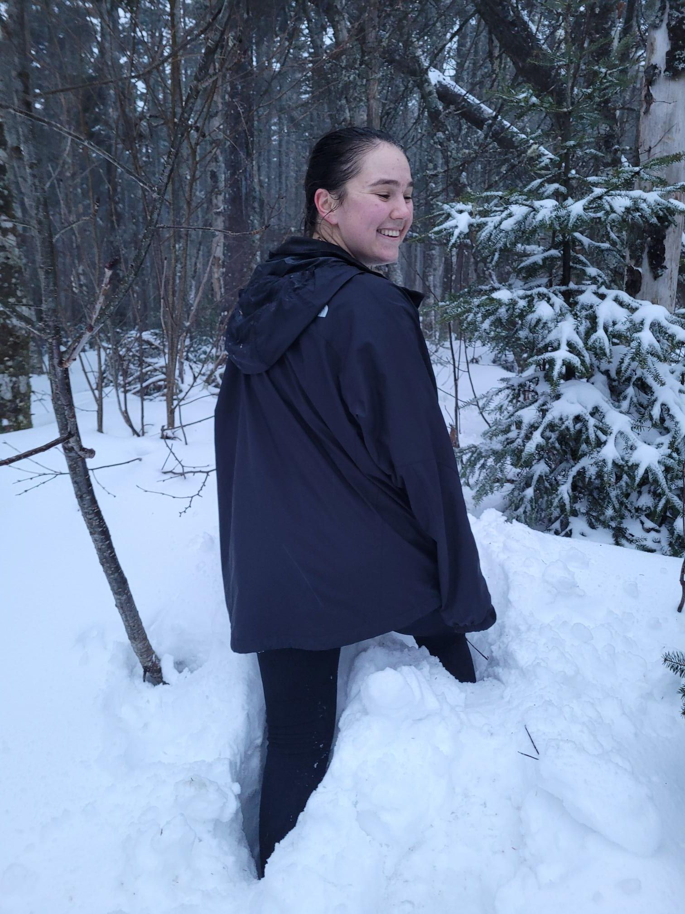

+++
title = "Fresh tracks in the dark to the bus"
description = "Hike — 2025-01-01"
date = 2025-01-01
authors = ["Max Katz-Christy"]

[taxonomies]
tags = ["Hike"]

[extra]
banner = "banner.jpg"
strava_id = 13242345386
distance_fmt = "10.75 km"
moving_time_fmt = "3h 47m 47s"
elevation_gain_fmt = "601 m"
+++

Forgot how late in the day it was, so we hiked in the dark and were going to hike on the road back to the start, but caught some random free bus!

## Stats

| | |
|---|---|
| **Distance** | 10.75 km |
| **Moving time** | 3h 47m 47s |
| **Elapsed time** | 4h 26m 26s |
| **Elevation gain** | 601 m |
| **Average pace** | 21:12 /km |
| **Best pace** | 3:55 /km |
| **Average cadence** | 53 rpm |
| **Calories** | 1269 kcal |
| **Device** | Garmin fēnix 6X |

## Route

{{ strava_map() }}

[View on Strava](https://www.strava.com/activities/13242345386)

## Photos

