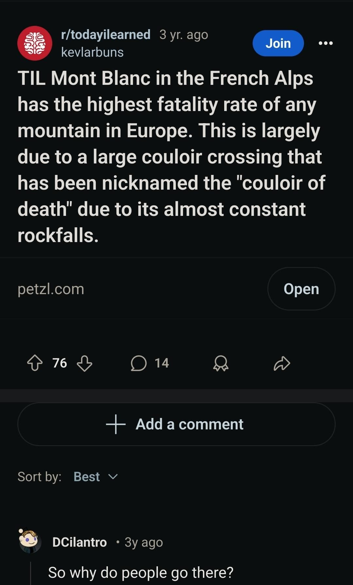

+++
title = "Didn't add to the death stats of mont blanc"
description = "AlpineSki — 2025-01-12"
date = 2025-01-12
authors = ["Max Katz-Christy"]

[taxonomies]
tags = ["AlpineSki"]

[extra]
banner = "banner.jpg"
strava_id = 13337941870
distance_fmt = "15.73 km"
moving_time_fmt = "1h 30m 17s"
elevation_gain_fmt = "127 m"
+++

## Stats

| | |
|---|---|
| **Distance** | 15.73 km |
| **Moving time** | 1h 30m 17s |
| **Elapsed time** | 3h 47m 38s |
| **Elevation gain** | 127 m |
| **Average speed** | 10.5 km/h |
| **Max speed** | 57.1 km/h |
| **Calories** | 729 kcal |
| **Achievements** | 7 |
| **Device** | Garmin fēnix 6X |

## Route

{{ strava_map() }}

[View on Strava](https://www.strava.com/activities/13337941870)

## Photos

