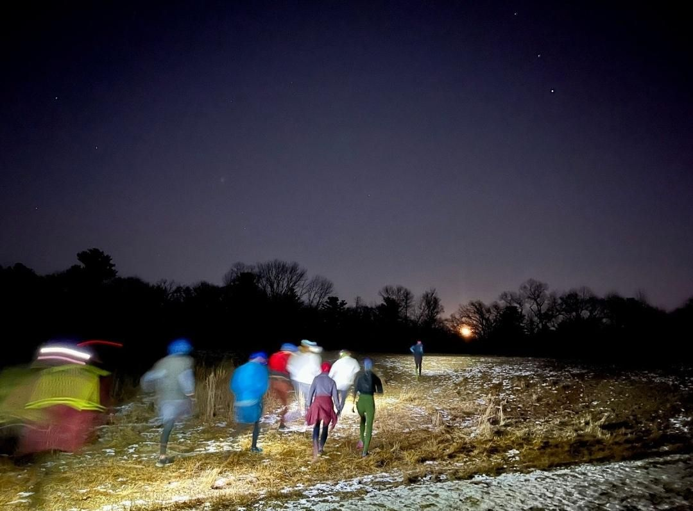

+++
title = "Didn't realize how much I missed ntc until I made it back"
description = "TrailRun — 2025-01-15"
date = 2025-01-15
authors = ["Max Katz-Christy"]

[taxonomies]
tags = ["TrailRun"]

[extra]
banner = "banner.jpg"
strava_id = 13366597247
distance_fmt = "9.23 km"
moving_time_fmt = "57m 27s"
elevation_gain_fmt = "148 m"
+++

## Stats

| | |
|---|---|
| **Distance** | 9.23 km |
| **Moving time** | 57m 27s |
| **Elapsed time** | 1h 07m 25s |
| **Elevation gain** | 148 m |
| **Average pace** | 6:13 /km |
| **Best pace** | 2:44 /km |
| **Average cadence** | 79 rpm |
| **Calories** | 745 kcal |
| **Achievements** | 4 |
| **Device** | Garmin fēnix 6X |

## Route

{{ strava_map() }}

[View on Strava](https://www.strava.com/activities/13366597247)

## Photos

