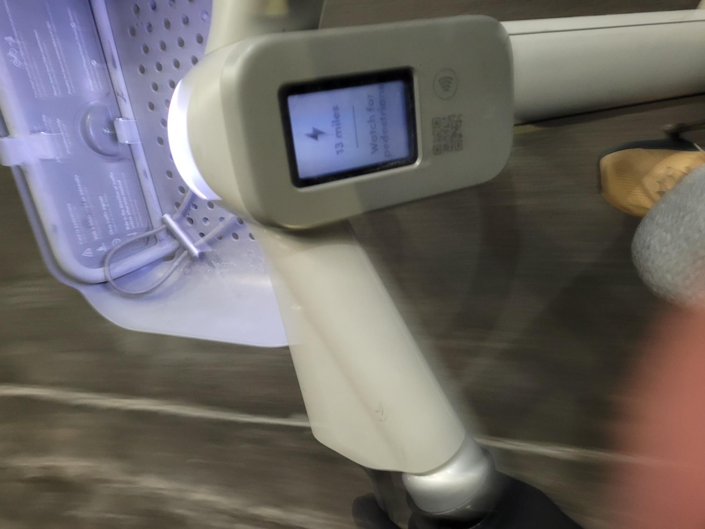

+++
title = "Microcenter return on the last day possible and last minute e bluebike dash to ntc"
description = "EBikeRide — 2025-01-15"
date = 2025-01-15
authors = ["Max Katz-Christy"]

[taxonomies]
tags = ["EBikeRide"]

[extra]
banner = "banner.jpg"
strava_id = 13366144367
distance_fmt = "10.13 km"
moving_time_fmt = "24m 00s"
elevation_gain_fmt = "70 m"
+++

this is the best way to get to the fells, i might actually make it to ntc more now

## Stats

| | |
|---|---|
| **Distance** | 10.13 km |
| **Moving time** | 24m 00s |
| **Elapsed time** | 24m 35s |
| **Elevation gain** | 70 m |
| **Average speed** | 25.3 km/h |
| **Max speed** | 32.5 km/h |
| **Calories** | 237 kcal |
| **Device** | Garmin fēnix 6X |

## Route

{{ strava_map() }}

[View on Strava](https://www.strava.com/activities/13366144367)

## Photos

