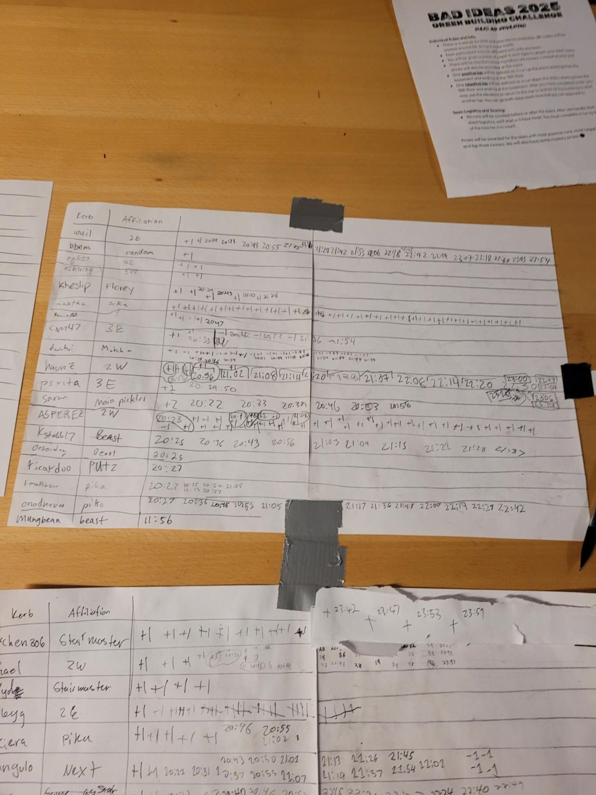

+++
title = "Spent a lot of time in the elevator"
description = "Hike — 2025-01-26"
date = 2025-01-26
authors = ["Max Katz-Christy"]

[taxonomies]
tags = ["Hike"]

[extra]
banner = "banner.jpg"
strava_id = 13463005980
distance_fmt = "12.50 km"
moving_time_fmt = "2h 26m 57s"
elevation_gain_fmt = "2096 m"
+++

Green building challenge, 37 times up, 2 times down

## Stats

| | |
|---|---|
| **Distance** | 12.50 km |
| **Moving time** | 2h 26m 57s |
| **Elapsed time** | 3h 52m 22s |
| **Elevation gain** | 2096 m |
| **Average pace** | 11:45 /km |
| **Best pace** | 0:58 /km |
| **Average cadence** | 54 rpm |
| **Calories** | 2005 kcal |
| **Device** | Garmin fēnix 6X |

## Route

{{ strava_map() }}

[View on Strava](https://www.strava.com/activities/13463005980)

## Photos

