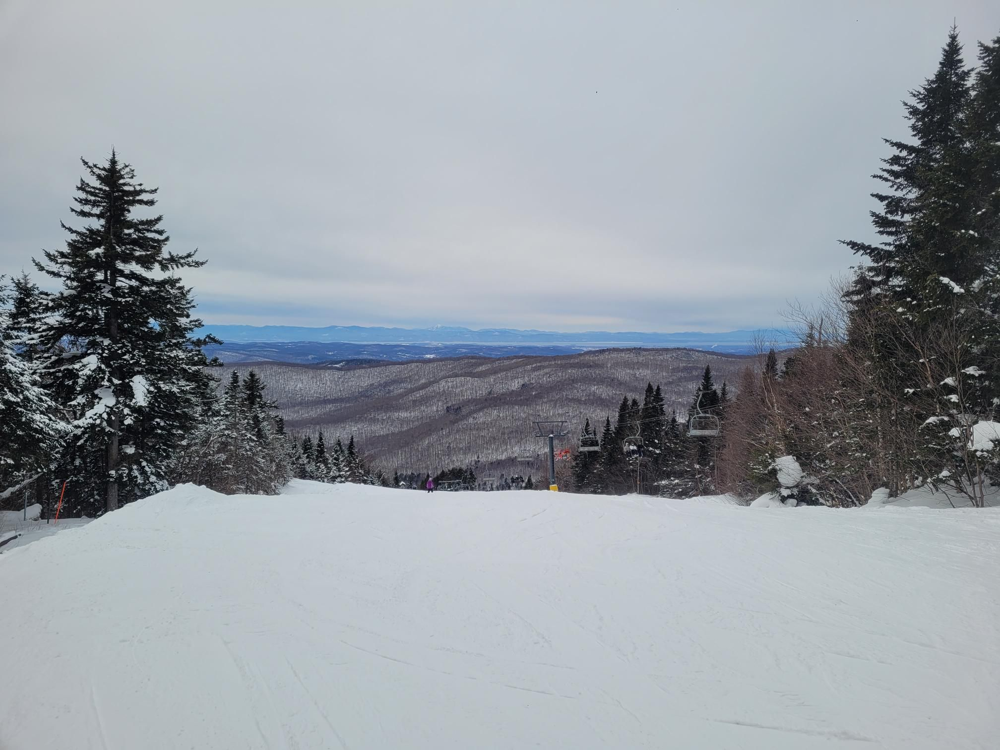

+++
title = "New Sport Day!"
description = "AlpineSki — 2025-02-02"
date = 2025-02-02
authors = ["Max Katz-Christy"]

[taxonomies]
tags = ["AlpineSki"]

[extra]
banner = "banner.jpg"
strava_id = 13523333992
distance_fmt = "25.09 km"
moving_time_fmt = "2h 00m 50s"
elevation_gain_fmt = "316 m"
+++

did two runs on the bunny hill on a snowboard. very fun, had some great coaching. also some HN one ski action

## Stats

| | |
|---|---|
| **Distance** | 25.09 km |
| **Moving time** | 2h 00m 50s |
| **Elapsed time** | 6h 04m 53s |
| **Elevation gain** | 316 m |
| **Average speed** | 12.5 km/h |
| **Max speed** | 52.4 km/h |
| **Calories** | 1095 kcal |
| **Achievements** | 11 |
| **Device** | Garmin fēnix 6X |

## Route

{{ strava_map() }}

[View on Strava](https://www.strava.com/activities/13523333992)

## Photos

