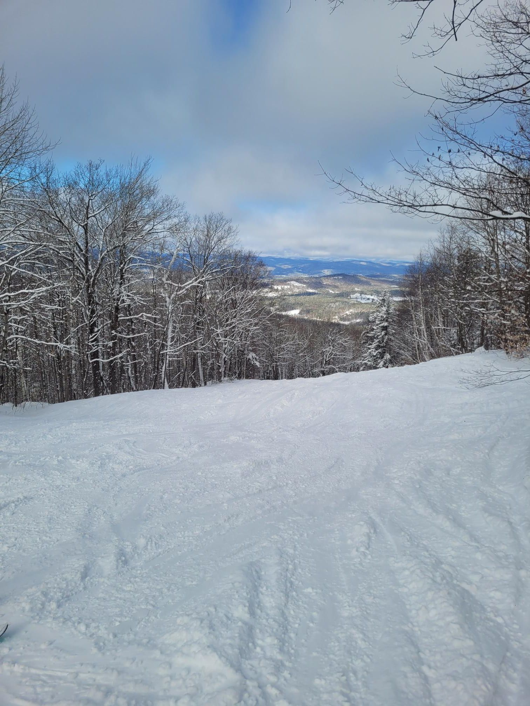

+++
title = "Always try discount codes"
description = "AlpineSki — 2025-02-09"
date = 2025-02-09
authors = ["Max Katz-Christy"]

[taxonomies]
tags = ["AlpineSki"]

[extra]
banner = "banner.jpg"
strava_id = 13586317243
distance_fmt = "21.36 km"
moving_time_fmt = "1h 36m 52s"
elevation_gain_fmt = "165 m"
+++

50% off for a little bit of trying

also ski polo? how would it work?

## Stats

| | |
|---|---|
| **Distance** | 21.36 km |
| **Moving time** | 1h 36m 52s |
| **Elapsed time** | 5h 32m 57s |
| **Elevation gain** | 165 m |
| **Average speed** | 13.2 km/h |
| **Max speed** | 46.7 km/h |
| **Calories** | 1135 kcal |
| **Achievements** | 7 |
| **Device** | Garmin fēnix 6X |

## Route

{{ strava_map() }}

[View on Strava](https://www.strava.com/activities/13586317243)

## Photos

