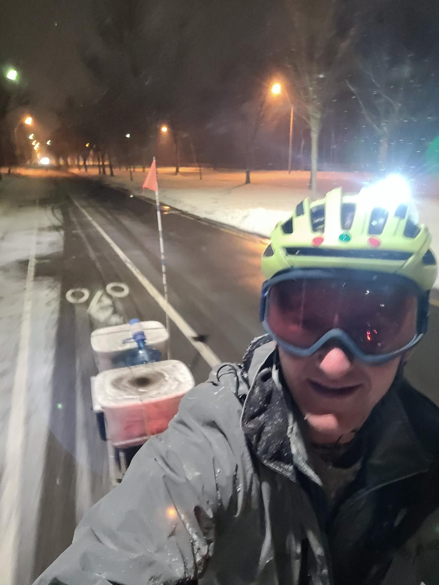

+++
title = "Everything was fine until the ice slope"
description = "EBikeRide — 2025-02-15"
date = 2025-02-15
authors = ["Max Katz-Christy"]

[taxonomies]
tags = ["EBikeRide"]

[extra]
banner = "banner.jpg"
strava_id = 13638542665
distance_fmt = "15.86 km"
moving_time_fmt = "1h 20m 29s"
elevation_gain_fmt = "190 m"
+++

i should have brought microspikes so i could push the ebike and trailer loaded with water up the slope. or gone in the other entrance

## Stats

| | |
|---|---|
| **Distance** | 15.86 km |
| **Moving time** | 1h 20m 29s |
| **Elapsed time** | 2h 01m 52s |
| **Elevation gain** | 190 m |
| **Average speed** | 11.8 km/h |
| **Max speed** | 34.1 km/h |
| **Calories** | 876 kcal |
| **Device** | Garmin fēnix 6X |

## Route

{{ strava_map() }}

[View on Strava](https://www.strava.com/activities/13638542665)

## Photos

