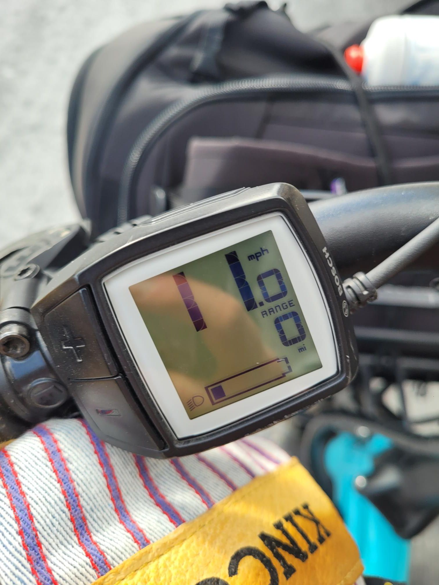

+++
title = "Battery almost made it"
description = "EBikeRide — 2025-02-17"
date = 2025-02-17
authors = ["Max Katz-Christy"]

[taxonomies]
tags = ["EBikeRide"]

[extra]
banner = "banner.jpg"
strava_id = 13653868067
distance_fmt = "27.45 km"
moving_time_fmt = "1h 33m 56s"
elevation_gain_fmt = "312 m"
+++

## Stats

| | |
|---|---|
| **Distance** | 27.45 km |
| **Moving time** | 1h 33m 56s |
| **Elapsed time** | 1h 37m 56s |
| **Elevation gain** | 312 m |
| **Average speed** | 17.5 km/h |
| **Max speed** | 39.0 km/h |
| **Calories** | 715 kcal |
| **Device** | Garmin fēnix 6X |

## Route

{{ strava_map() }}

[View on Strava](https://www.strava.com/activities/13653868067)

## Photos

