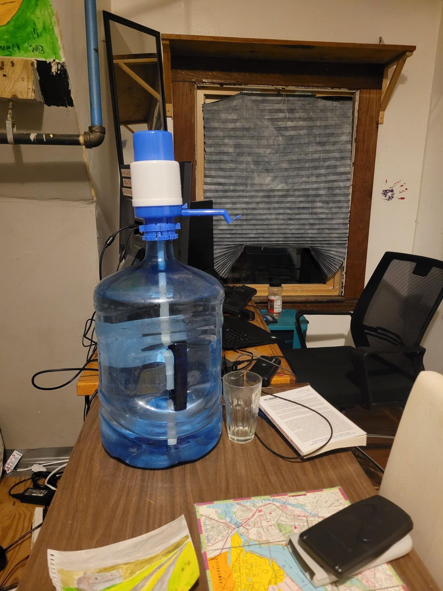

+++
title = "I've upgraded to electric pump"
description = "Run — 2025-02-27"
date = 2025-02-27
authors = ["Max Katz-Christy"]

[taxonomies]
tags = ["Run"]

[extra]
banner = "banner.jpg"
strava_id = 13740877604
distance_fmt = "5.53 km"
moving_time_fmt = "24m 13s"
elevation_gain_fmt = "16 m"
+++

(not pictured here, thats the old version)

## Stats

| | |
|---|---|
| **Distance** | 5.53 km |
| **Moving time** | 24m 13s |
| **Elapsed time** | 24m 55s |
| **Elevation gain** | 16 m |
| **Average pace** | 4:22 /km |
| **Best pace** | 2:29 /km |
| **Average cadence** | 84 rpm |
| **Calories** | 348 kcal |
| **Achievements** | 4 |
| **Device** | Garmin fēnix 6X |

## Route

{{ strava_map() }}

[View on Strava](https://www.strava.com/activities/13740877604)

## Photos

