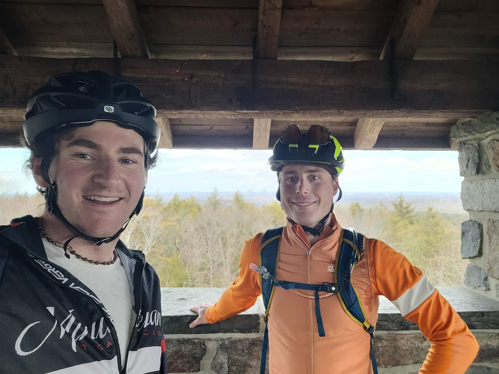

+++
title = "Hills and gravel mix on a roadbike"
description = "Ride — 2025-03-09"
date = 2025-03-09
authors = ["Max Katz-Christy"]

[taxonomies]
tags = ["Ride"]

[extra]
banner = "banner.jpg"
strava_id = 13837552401
distance_fmt = "44.68 km"
moving_time_fmt = "2h 33m 47s"
elevation_gain_fmt = "574 m"
+++

arboretum, blue hills, gravel trails, 2 for 1 beantown, all great ways to avoid doing work

## Stats

| | |
|---|---|
| **Distance** | 44.68 km |
| **Moving time** | 2h 33m 47s |
| **Elapsed time** | 3h 07m 13s |
| **Elevation gain** | 574 m |
| **Average speed** | 17.4 km/h |
| **Max speed** | 45.7 km/h |
| **Calories** | 1034 kcal |
| **Achievements** | 27 |
| **Device** | Garmin fēnix 6X |

## Route

{{ strava_map() }}

[View on Strava](https://www.strava.com/activities/13837552401)

## Photos

