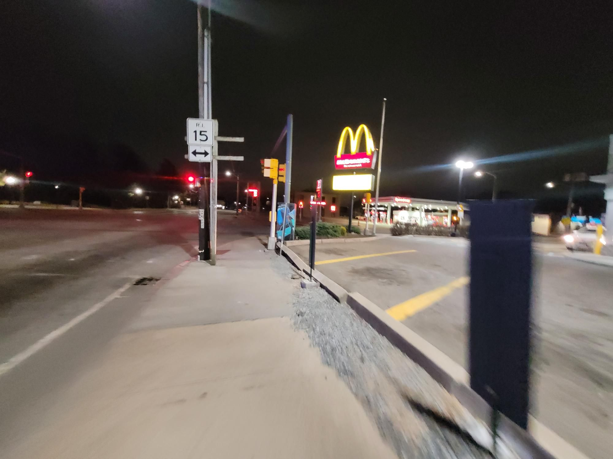

+++
title = "To the next event"
description = "Run — 2025-03-13"
date = 2025-03-13
authors = ["Max Katz-Christy"]

[taxonomies]
tags = ["Run"]

[extra]
banner = "banner.jpg"
strava_id = 13877254186
distance_fmt = "2.40 km"
moving_time_fmt = "12m 19s"
elevation_gain_fmt = "11 m"
+++

## Stats

| | |
|---|---|
| **Distance** | 2.40 km |
| **Moving time** | 12m 19s |
| **Elapsed time** | 16m 58s |
| **Elevation gain** | 11 m |
| **Average pace** | 5:08 /km |
| **Best pace** | 2:25 /km |
| **Average cadence** | 80 rpm |
| **Calories** | 182 kcal |
| **Device** | Garmin fēnix 6X |

## Route

{{ strava_map() }}

[View on Strava](https://www.strava.com/activities/13877254186)

## Photos

