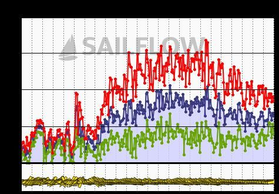

+++
title = "Heavy air crewing"
description = "Sail — 2025-03-21"
date = 2025-03-21
authors = ["Max Katz-Christy"]

[taxonomies]
tags = ["Sail"]

[extra]
banner = "banner.jpg"
strava_id = 13948580283
distance_fmt = "4.30 km"
moving_time_fmt = "34m 29s"
elevation_gain_fmt = "0 m"
+++

Super fun

## Stats

| | |
|---|---|
| **Distance** | 4.30 km |
| **Moving time** | 34m 29s |
| **Elapsed time** | 41m 10s |
| **Elevation gain** | 0 m |
| **Average speed** | 7.5 km/h |
| **Max speed** | 14.5 km/h |
| **Average cadence** | 20 rpm |
| **Calories** | 960 kcal |
| **Device** | Garmin fēnix 6X |

## Route

{{ strava_map() }}

[View on Strava](https://www.strava.com/activities/13948580283)

## Photos

