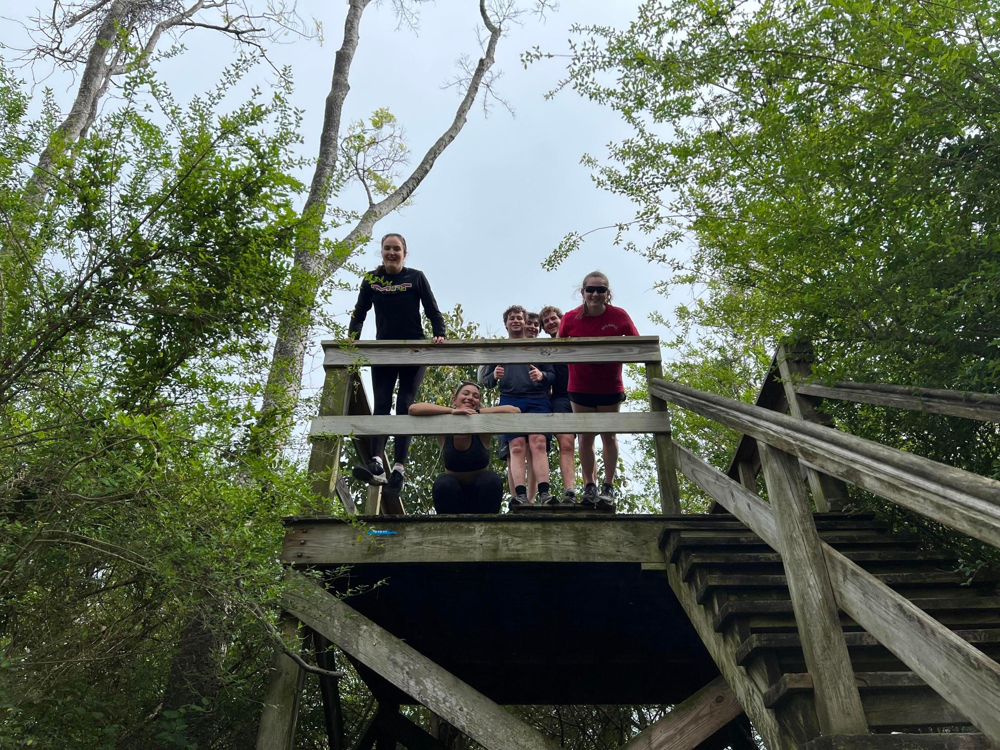

+++
title = "Don't duck hunt on the golf course"
description = "Run — 2025-03-24"
date = 2025-03-24
authors = ["Max Katz-Christy"]

[taxonomies]
tags = ["Run"]

[extra]
banner = "banner.jpg"
strava_id = 13976045956
distance_fmt = "3.50 km"
moving_time_fmt = "18m 23s"
elevation_gain_fmt = "15 m"
+++

## Stats

| | |
|---|---|
| **Distance** | 3.50 km |
| **Moving time** | 18m 23s |
| **Elapsed time** | 29m 54s |
| **Elevation gain** | 15 m |
| **Average pace** | 5:15 /km |
| **Best pace** | 2:02 /km |
| **Average cadence** | 81 rpm |
| **Calories** | 274 kcal |
| **Device** | Garmin fēnix 6X |

## Route

{{ strava_map() }}

[View on Strava](https://www.strava.com/activities/13976045956)

## Photos

