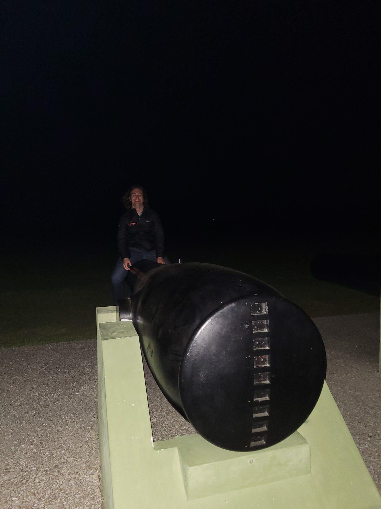

+++
title = "Beware of the hotel landscaping"
description = "Run — 2025-03-26"
date = 2025-03-26
authors = ["Max Katz-Christy"]

[taxonomies]
tags = ["Run"]

[extra]
banner = "banner.jpg"
strava_id = 13992285155
distance_fmt = "2.21 km"
moving_time_fmt = "12m 01s"
elevation_gain_fmt = "6 m"
+++

It's never the things you expect

## Stats

| | |
|---|---|
| **Distance** | 2.21 km |
| **Moving time** | 12m 01s |
| **Elapsed time** | 13m 20s |
| **Elevation gain** | 6 m |
| **Average pace** | 5:25 /km |
| **Best pace** | 3:26 /km |
| **Average cadence** | 82 rpm |
| **Calories** | 152 kcal |
| **Device** | Garmin fēnix 6X |

## Route

{{ strava_map() }}

[View on Strava](https://www.strava.com/activities/13992285155)

## Photos

