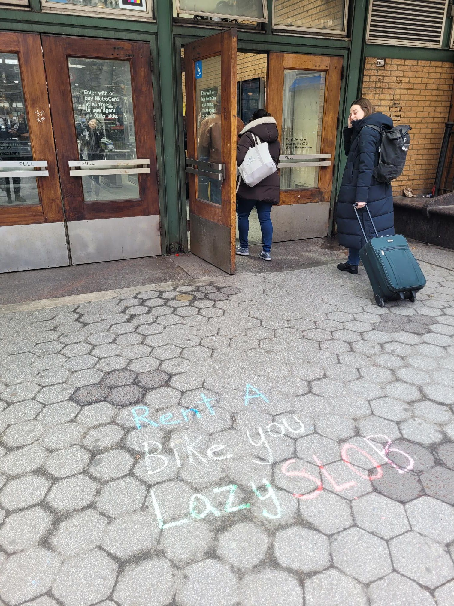

+++
title = "This was right before I realized I was about to be suuper late to the wedding"
description = "Run — 2025-04-12"
date = 2025-04-12
authors = ["Max Katz-Christy"]

[taxonomies]
tags = ["Run"]

[extra]
banner = "banner.jpg"
strava_id = 14158502048
distance_fmt = "1.68 km"
moving_time_fmt = "9m 09s"
elevation_gain_fmt = "19 m"
+++

Which was fixed by more stressful non recorded backpack NYC rain running

## Stats

| | |
|---|---|
| **Distance** | 1.68 km |
| **Moving time** | 9m 09s |
| **Elapsed time** | 9m 24s |
| **Elevation gain** | 19 m |
| **Average pace** | 5:25 /km |
| **Best pace** | 3:45 /km |
| **Average cadence** | 82 rpm |
| **Calories** | 120 kcal |
| **Device** | Garmin fēnix 6X |

## Route

{{ strava_map() }}

[View on Strava](https://www.strava.com/activities/14158502048)

## Photos

