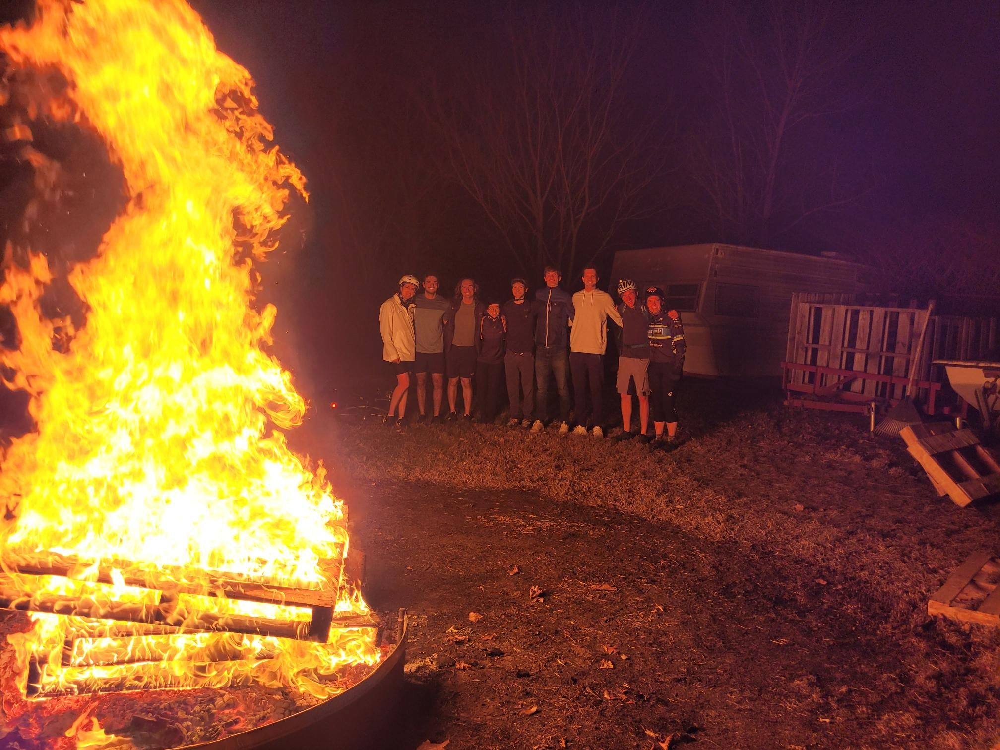

+++
title = "Finally nice weather for the midnight marathon"
description = "Ride — 2025-04-20"
date = 2025-04-20
authors = ["Max Katz-Christy"]

[taxonomies]
tags = ["Ride"]

[extra]
banner = "banner.jpg"
strava_id = 14238572057
distance_fmt = "88.13 km"
moving_time_fmt = "4h 19m 03s"
elevation_gain_fmt = "697 m"
+++

It was incredibly pleasant and I ran into lots of fun people!

## Stats

| | |
|---|---|
| **Distance** | 88.13 km |
| **Moving time** | 4h 19m 03s |
| **Elapsed time** | 6h 29m 20s |
| **Elevation gain** | 697 m |
| **Average speed** | 20.4 km/h |
| **Max speed** | 46.3 km/h |
| **Calories** | 2013 kcal |
| **Achievements** | 137 |
| **Device** | Garmin fēnix 6X |

## Route

{{ strava_map() }}

[View on Strava](https://www.strava.com/activities/14238572057)

## Photos

