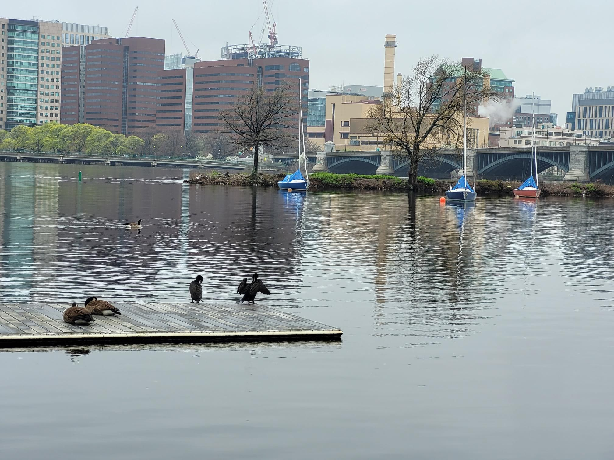

+++
title = "Cancelled lift"
description = "Run — 2025-04-22"
date = 2025-04-22
authors = ["Max Katz-Christy"]

[taxonomies]
tags = ["Run"]

[extra]
banner = "banner.jpg"
strava_id = 14251741100
distance_fmt = "10.35 km"
moving_time_fmt = "49m 12s"
elevation_gain_fmt = "34 m"
+++

Put the marathon running in perspective lol they are very fast

## Stats

| | |
|---|---|
| **Distance** | 10.35 km |
| **Moving time** | 49m 12s |
| **Elapsed time** | 50m 10s |
| **Elevation gain** | 34 m |
| **Average pace** | 4:45 /km |
| **Best pace** | 2:51 /km |
| **Average cadence** | 83 rpm |
| **Calories** | 651 kcal |
| **Achievements** | 19 |
| **Device** | Garmin fēnix 6X |

## Route

{{ strava_map() }}

[View on Strava](https://www.strava.com/activities/14251741100)

## Photos

