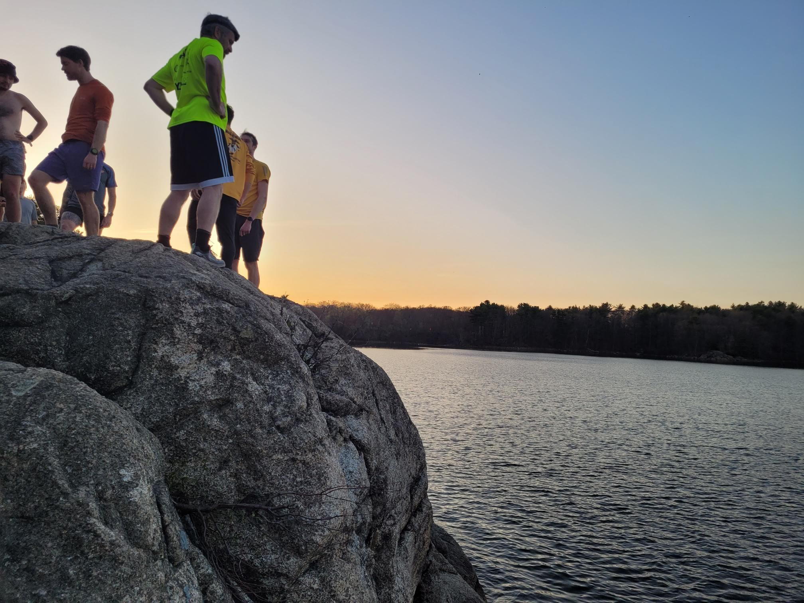

+++
title = "So many homes"
description = "TrailRun — 2025-04-23"
date = 2025-04-23
authors = ["Max Katz-Christy"]

[taxonomies]
tags = ["TrailRun"]

[extra]
banner = "banner.jpg"
strava_id = 14267882197
distance_fmt = "10.46 km"
moving_time_fmt = "1h 08m 33s"
elevation_gain_fmt = "236 m"
+++

Back to NTC, past my original home, my temporary spot in Central, and finally my freshman year dorm (they've got a puppy now!)

## Stats

| | |
|---|---|
| **Distance** | 10.46 km |
| **Moving time** | 1h 08m 33s |
| **Elapsed time** | 1h 16m 00s |
| **Elevation gain** | 236 m |
| **Average pace** | 6:33 /km |
| **Best pace** | 3:08 /km |
| **Average cadence** | 76 rpm |
| **Calories** | 781 kcal |
| **Achievements** | 1 |
| **Device** | Garmin fēnix 6X |

## Route

{{ strava_map() }}

[View on Strava](https://www.strava.com/activities/14267882197)

## Photos

