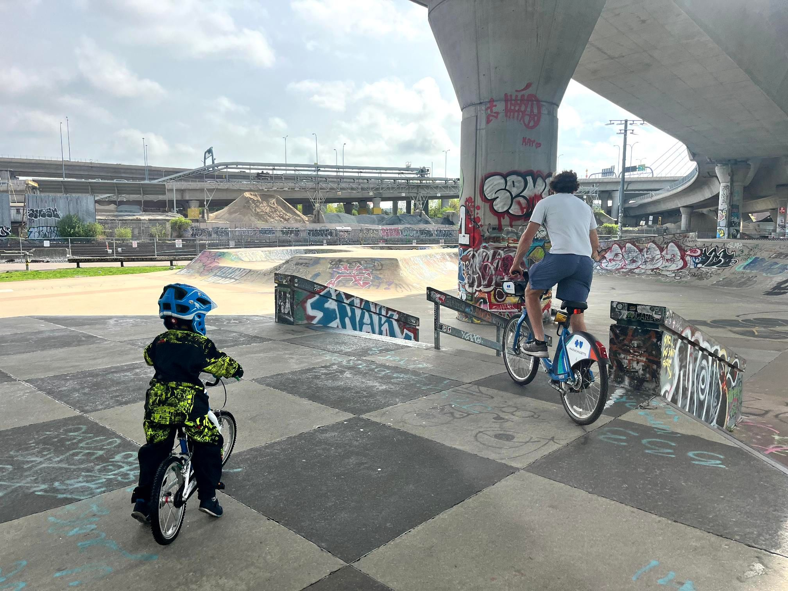

+++
title = "Amateur hour at the skate park"
description = "Run — 2025-05-04"
date = 2025-05-04
authors = ["Max Katz-Christy"]

[taxonomies]
tags = ["Run"]

[extra]
banner = "banner.jpg"
strava_id = 14375713570
distance_fmt = "8.64 km"
moving_time_fmt = "54m 08s"
elevation_gain_fmt = "38 m"
+++

## Stats

| | |
|---|---|
| **Distance** | 8.64 km |
| **Moving time** | 54m 08s |
| **Elapsed time** | 1h 14m 20s |
| **Elevation gain** | 38 m |
| **Average pace** | 6:15 /km |
| **Best pace** | 2:10 /km |
| **Average cadence** | 80 rpm |
| **Calories** | 614 kcal |
| **Achievements** | 18 |
| **Device** | Garmin fēnix 6X |

## Route

{{ strava_map() }}

[View on Strava](https://www.strava.com/activities/14375713570)

## Photos

