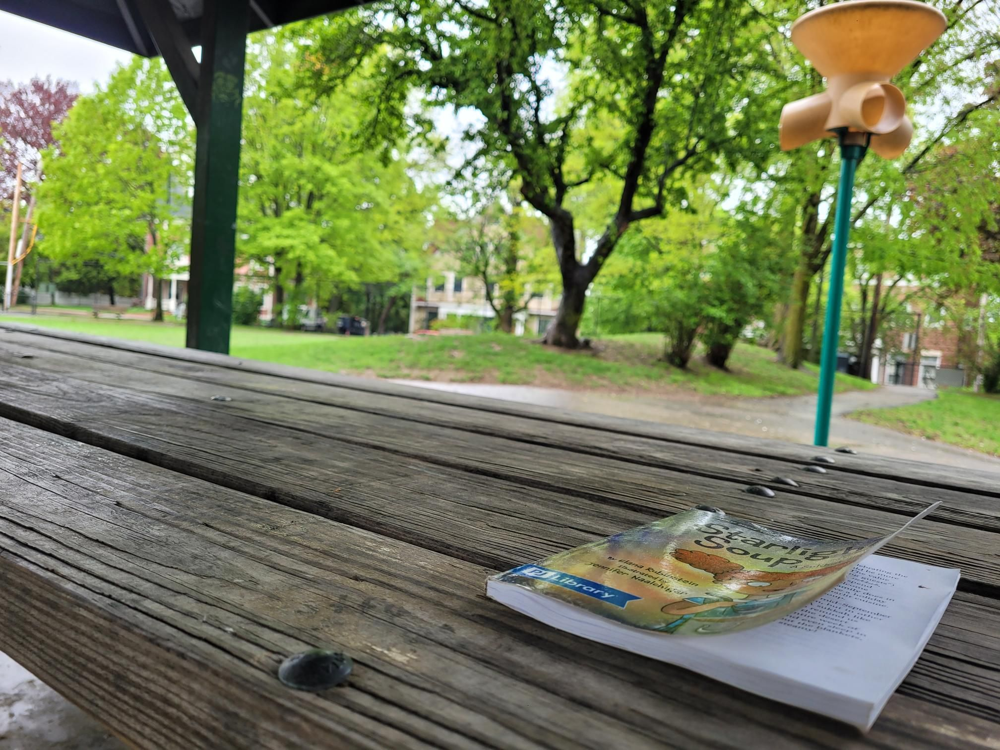

+++
title = "I love little hilltop parks"
description = "Run — 2025-05-10"
date = 2025-05-10
authors = ["Max Katz-Christy"]

[taxonomies]
tags = ["Run"]

[extra]
banner = "banner.jpg"
strava_id = 14439849195
distance_fmt = "25.12 km"
moving_time_fmt = "3h 01m 50s"
elevation_gain_fmt = "229 m"
+++

Thanks Maaya Prasad for the hour long walk intermission chat

Also, I haven't sent it to you yet, come on Thursday to the pump track! https://www.easy-rsvp.com/xOuzZO-pizza-and-field-games-at-the-pump-track-for-my-birthday

## Stats

| | |
|---|---|
| **Distance** | 25.12 km |
| **Moving time** | 3h 01m 50s |
| **Elapsed time** | 3h 12m 23s |
| **Elevation gain** | 229 m |
| **Average pace** | 7:14 /km |
| **Best pace** | 3:04 /km |
| **Average cadence** | 68 rpm |
| **Calories** | 1730 kcal |
| **Achievements** | 2 |
| **Device** | Garmin fēnix 6X |

## Route

{{ strava_map() }}

[View on Strava](https://www.strava.com/activities/14439849195)

## Photos

