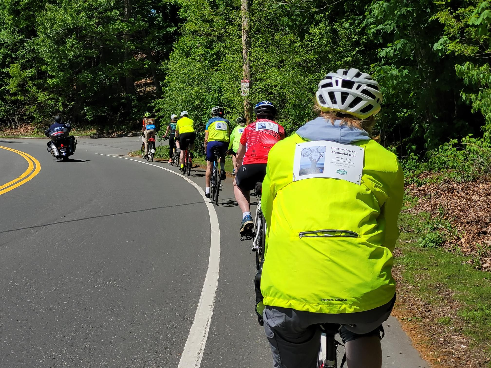

+++
title = "Charlie Proctor Memorial Ride"
description = "Ride — 2025-05-11"
date = 2025-05-11
authors = ["Max Katz-Christy"]

[taxonomies]
tags = ["Ride"]

[extra]
banner = "banner.jpg"
strava_id = 14449997923
distance_fmt = "77.30 km"
moving_time_fmt = "4h 20m 25s"
elevation_gain_fmt = "495 m"
+++

And a sneaky Max Hessinger spotting. First time volunteering as a ride leader for massbike!

## Stats

| | |
|---|---|
| **Distance** | 77.30 km |
| **Moving time** | 4h 20m 25s |
| **Elapsed time** | 6h 04m 19s |
| **Elevation gain** | 495 m |
| **Average speed** | 17.8 km/h |
| **Max speed** | 45.5 km/h |
| **Calories** | 1463 kcal |
| **Achievements** | 47 |
| **Device** | Garmin fēnix 6X |

## Route

{{ strava_map() }}

[View on Strava](https://www.strava.com/activities/14449997923)

## Photos

