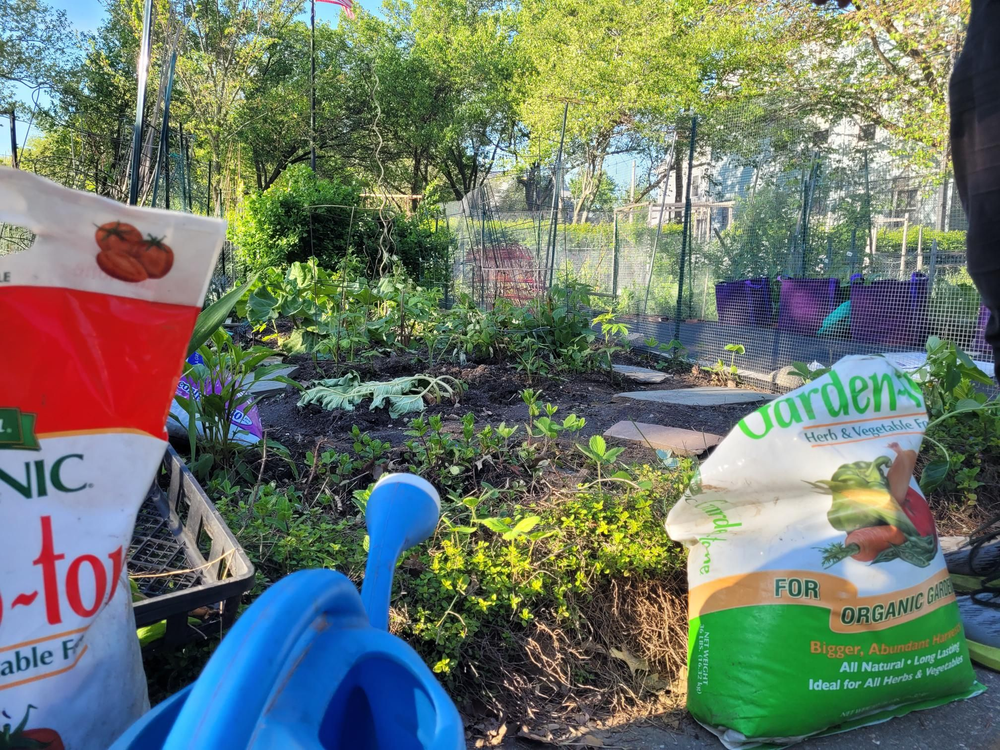

+++
title = "Home for mother's day!"
description = "Ride — 2025-05-11"
date = 2025-05-11
authors = ["Max Katz-Christy"]

[taxonomies]
tags = ["Ride"]

[extra]
banner = "banner.jpg"
strava_id = 14450412218
distance_fmt = "5.63 km"
moving_time_fmt = "13m 26s"
elevation_gain_fmt = "37 m"
+++

Time to do some gardening

## Stats

| | |
|---|---|
| **Distance** | 5.63 km |
| **Moving time** | 13m 26s |
| **Elapsed time** | 13m 48s |
| **Elevation gain** | 37 m |
| **Average speed** | 25.2 km/h |
| **Max speed** | 37.3 km/h |
| **Calories** | 88 kcal |
| **Achievements** | 7 |
| **Device** | Garmin fēnix 6X |

## Route

{{ strava_map() }}

[View on Strava](https://www.strava.com/activities/14450412218)

## Photos

