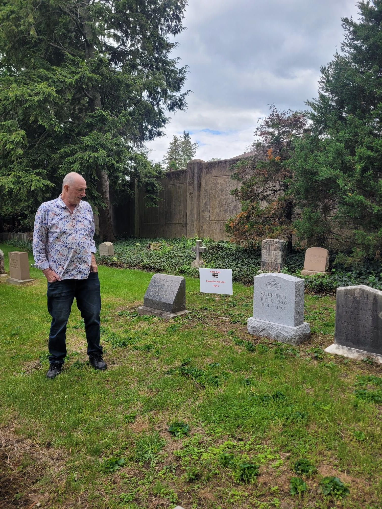

+++
title = "Kittie Knox Ride"
description = "Ride — 2025-05-18"
date = 2025-05-18
authors = ["Max Katz-Christy"]

[taxonomies]
tags = ["Ride"]

[extra]
banner = "banner.jpg"
strava_id = 14523544812
distance_fmt = "46.55 km"
moving_time_fmt = "3h 05m 45s"
elevation_gain_fmt = "258 m"
+++

Leading for a Mass Bike ride again, this time on the Brompton!

## Stats

| | |
|---|---|
| **Distance** | 46.55 km |
| **Moving time** | 3h 05m 45s |
| **Elapsed time** | 8h 01m 31s |
| **Elevation gain** | 258 m |
| **Average speed** | 15.0 km/h |
| **Max speed** | 42.3 km/h |
| **Calories** | 1415 kcal |
| **Achievements** | 13 |
| **Device** | Garmin fēnix 6X |

## Route

{{ strava_map() }}

[View on Strava](https://www.strava.com/activities/14523544812)

## Photos

