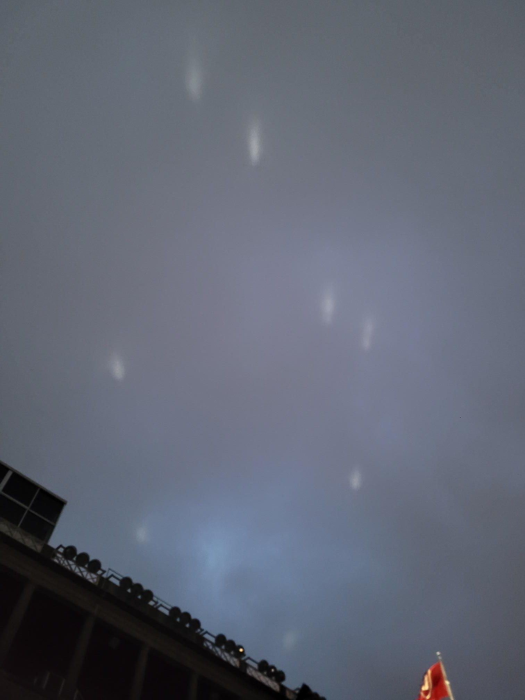

+++
title = "Aliens?"
description = "Run — 2025-05-20"
date = 2025-05-20
authors = ["Max Katz-Christy"]

[taxonomies]
tags = ["Run"]

[extra]
banner = "banner.jpg"
strava_id = 14546476704
distance_fmt = "15.30 km"
moving_time_fmt = "1h 58m 24s"
elevation_gain_fmt = "476 m"
+++

Above Harvard stadium there were these weird lights bouncing around in the sky that after like 15 minutes stabilized 🤯

Stadium made the laps around the pump track kinda exhausting, but a good follow up to the muddy and bike tuneups

## Stats

| | |
|---|---|
| **Distance** | 15.30 km |
| **Moving time** | 1h 58m 24s |
| **Elapsed time** | 2h 08m 48s |
| **Elevation gain** | 476 m |
| **Average pace** | 7:44 /km |
| **Best pace** | 3:11 /km |
| **Average cadence** | 76 rpm |
| **Calories** | 1279 kcal |
| **Achievements** | 1 |
| **Device** | Garmin fēnix 6X |

## Route

{{ strava_map() }}

[View on Strava](https://www.strava.com/activities/14546476704)

## Photos

