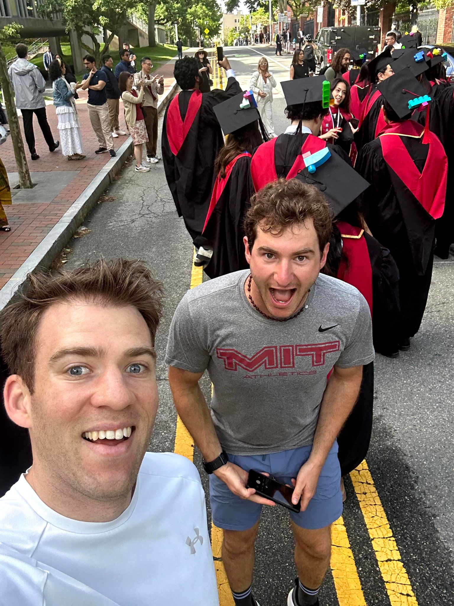

+++
title = "Run and coffee date with Seth"
description = "Run — 2025-05-29"
date = 2025-05-29
authors = ["Max Katz-Christy"]

[taxonomies]
tags = ["Run"]

[extra]
banner = "banner.jpg"
strava_id = 14631379963
distance_fmt = "15.66 km"
moving_time_fmt = "1h 36m 27s"
elevation_gain_fmt = "54 m"
+++

He gave me the booth and everything. We went back to his parents place after. Hopefully we're not too closely related...

Also my first Nemo spotting ("the AAA for bicycles")

## Stats

| | |
|---|---|
| **Distance** | 15.66 km |
| **Moving time** | 1h 36m 27s |
| **Elapsed time** | 2h 37m 44s |
| **Elevation gain** | 54 m |
| **Average pace** | 6:09 /km |
| **Best pace** | 3:00 /km |
| **Average cadence** | 81 rpm |
| **Calories** | 1113 kcal |
| **Achievements** | 9 |
| **Device** | Garmin fēnix 6X |

## Route

{{ strava_map() }}

[View on Strava](https://www.strava.com/activities/14631379963)

## Photos

