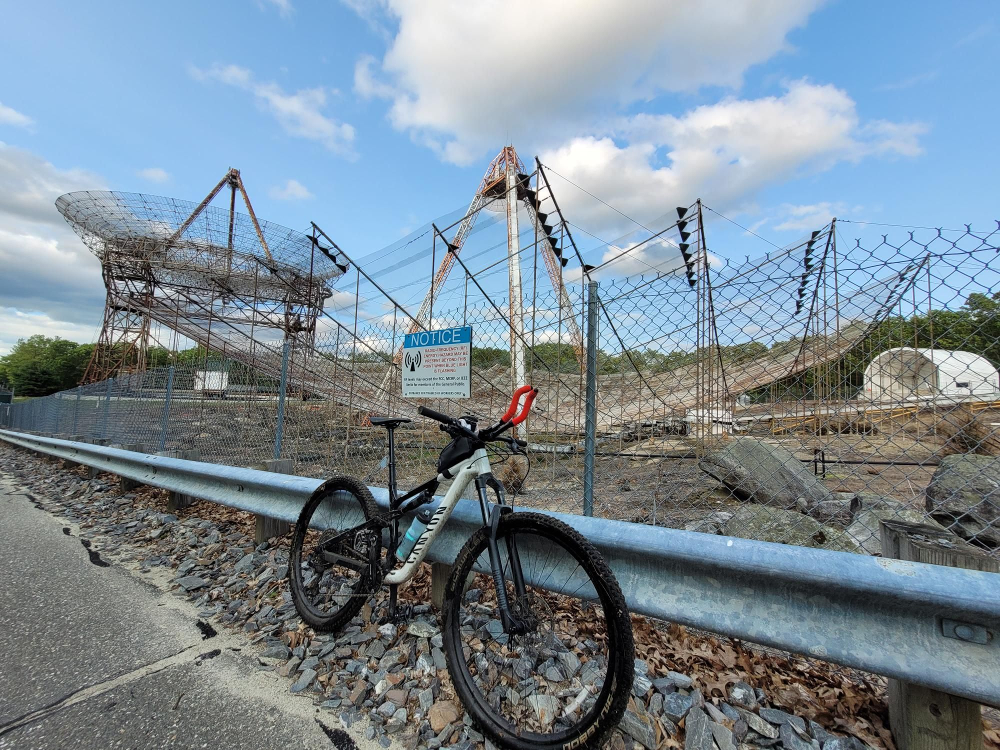

+++
title = "Bike rides are a lot more eventful when you don't plan them 😬"
description = "MountainBikeRide — 2025-06-01"
date = 2025-06-01
authors = ["Max Katz-Christy"]

[taxonomies]
tags = ["MountainBikeRide"]

[extra]
banner = "banner.jpg"
strava_id = 14668482717
distance_fmt = "117.73 km"
moving_time_fmt = "9h 20m 50s"
elevation_gain_fmt = "1323 m"
+++

I thought I'd make it home before hopping on the train, but adding sealant was trickier than I expected... So I hopped on the train with 60% charge and no way to charge it, 1 water bottle, a small multi tool with only Allen keys <= 6mm, and around 12 bike greased gummy bears raw dogging the bag. I was very optimistic about finding food and water in places, little did I know that I was slow as shit in the woods and it would take me the full bottle to get even to West Groton. I bummed a fill-up off of a couple blowing leaves in their driveway which was a big save (I had gummy bears but I couldn't eat more because they'd make me thirsty). In Groton I was recommended the bucket of meatballs at a nice Italian deli/restaurant which was fantastic. Apparently they didn't expect me to inhale them at the place so the guy comes running out and offers to heat them up for me. I explained to the nice old couple who was chatting up this specimen of a cyclist that the cold meatballs were like cold pizza and they seemed satisfied. I had one leftover meatball and made a top tube bag meatball sub.

I quickly ran out of water again (yeah, fool me once, fool me again, and again, and again, I'm stubborn). I looked longingly at the puddles and streams blocking my way, sticking my tongue out every time it drizzled a bit. Finally, two no trespassings, one dog tick, and a sunset later I arrived at an unfortunately closed concord market. However, there was a sneaky little spigot that allowed me to swallow my little meatball sub.

I didn't finish the route. They weren't kidding about it being tough and 10h/all day. I did not take the 8am train. I'm a fool. However, despite multiple reroutes and tough high water crossings, I did make it on the route to Concord, and then ripped in the darkness on the more comfy trails back to Boston. Overall, fun ride!

https://www.urbandirt.org/routes/trains-lemons-and-dirt

I also met Vincent on the train out, an architect turned pro cyclist (technically) because his bike tour is funded for research purposes. Clever guy.

## Stats

| | |
|---|---|
| **Distance** | 117.73 km |
| **Moving time** | 9h 20m 50s |
| **Elapsed time** | 10h 23m 35s |
| **Elevation gain** | 1323 m |
| **Average speed** | 12.6 km/h |
| **Max speed** | 53.9 km/h |
| **Calories** | 3580 kcal |
| **Achievements** | 38 |
| **Device** | Garmin fēnix 6X |

## Route

{{ strava_map() }}

[View on Strava](https://www.strava.com/activities/14668482717)

## Photos

