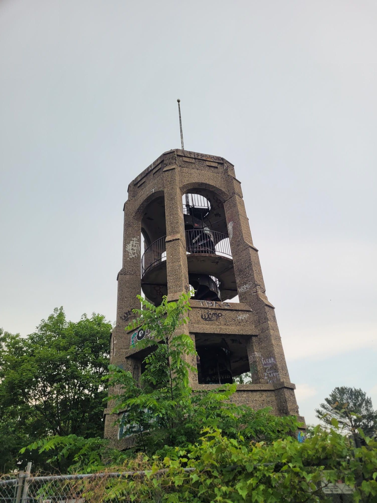

+++
title = "Getting the full Fells tour from Matthew"
description = "MountainBikeRide — 2025-06-06"
date = 2025-06-06
authors = ["Max Katz-Christy"]

[taxonomies]
tags = ["MountainBikeRide"]

[extra]
banner = "banner.jpg"
strava_id = 14717658678
distance_fmt = "24.76 km"
moving_time_fmt = "1h 57m 44s"
elevation_gain_fmt = "391 m"
+++

Felix Knollmann you gotta try Inline Skating w me soon. I think it's gonna be your next big sport!

## Stats

| | |
|---|---|
| **Distance** | 24.76 km |
| **Moving time** | 1h 57m 44s |
| **Elapsed time** | 2h 03m 33s |
| **Elevation gain** | 391 m |
| **Average speed** | 12.6 km/h |
| **Max speed** | 37.0 km/h |
| **Calories** | 880 kcal |
| **Achievements** | 14 |
| **Device** | Garmin fēnix 6X |

## Route

{{ strava_map() }}

[View on Strava](https://www.strava.com/activities/14717658678)

## Photos

