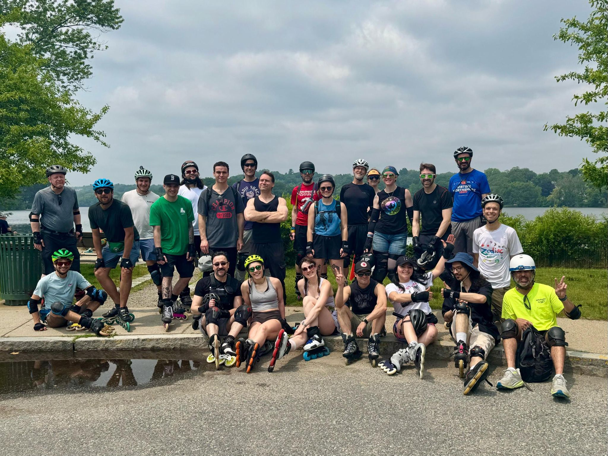

+++
title = "Skating familiar places"
description = "Ride — 2025-06-08"
date = 2025-06-08
authors = ["Max Katz-Christy"]

[taxonomies]
tags = ["Ride"]

[extra]
banner = "banner.jpg"
strava_id = 14736363287
distance_fmt = "20.05 km"
moving_time_fmt = "1h 22m 39s"
elevation_gain_fmt = "91 m"
+++

My first SMS! Jackson Moore-Otto spotting.

Also Garmin gritty score is funny

## Stats

| | |
|---|---|
| **Distance** | 20.05 km |
| **Moving time** | 1h 22m 39s |
| **Elapsed time** | 2h 15m 08s |
| **Elevation gain** | 91 m |
| **Average speed** | 14.6 km/h |
| **Max speed** | 28.2 km/h |
| **Calories** | 755 kcal |
| **Achievements** | 9 |
| **Device** | Garmin fēnix 6X |

## Route

{{ strava_map() }}

[View on Strava](https://www.strava.com/activities/14736363287)

## Photos

