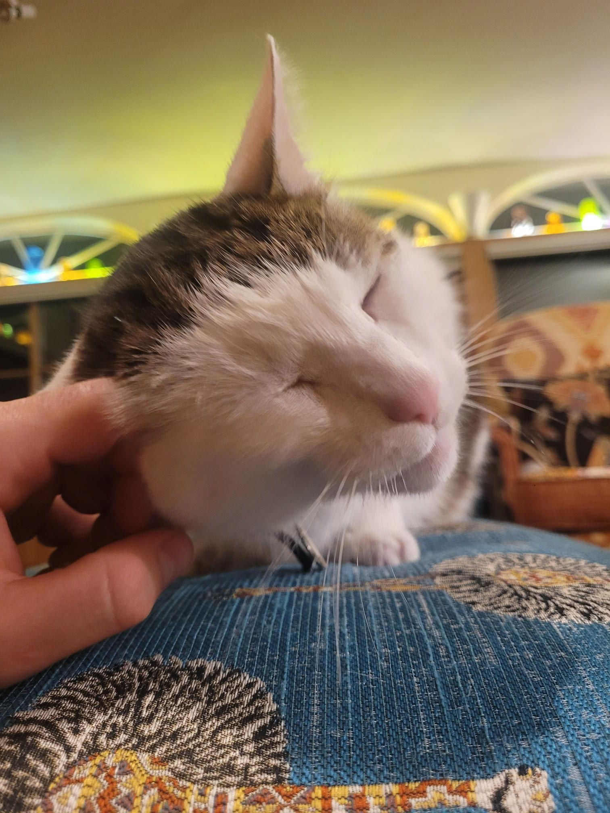

+++
title = "Got a partiful 2h notification on the way to the most humid NTC in a long time"
description = "TrailRun — 2025-06-18"
date = 2025-06-18
authors = ["Max Katz-Christy"]

[taxonomies]
tags = ["TrailRun"]

[extra]
banner = "banner.jpg"
strava_id = 14844681506
distance_fmt = "11.15 km"
moving_time_fmt = "1h 13m 02s"
elevation_gain_fmt = "219 m"
+++

Still made it, very fashionably late

+ Ollie spent the night at the KC campus

## Stats

| | |
|---|---|
| **Distance** | 11.15 km |
| **Moving time** | 1h 13m 02s |
| **Elapsed time** | 1h 34m 54s |
| **Elevation gain** | 219 m |
| **Average pace** | 6:32 /km |
| **Best pace** | 2:58 /km |
| **Average cadence** | 77 rpm |
| **Calories** | 918 kcal |
| **Achievements** | 8 |
| **Device** | Garmin fēnix 6X |

## Route

{{ strava_map() }}

[View on Strava](https://www.strava.com/activities/14844681506)

## Photos

