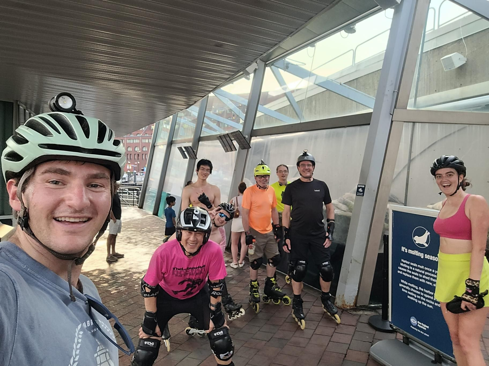

+++
title = "ThNS: It's Molting Season"
description = "InlineSkate — 2025-06-19"
date = 2025-06-19
authors = ["Max Katz-Christy"]

[taxonomies]
tags = ["InlineSkate"]

[extra]
banner = "banner.jpg"
strava_id = 14856104550
distance_fmt = "35.07 km"
moving_time_fmt = "2h 18m 30s"
elevation_gain_fmt = "155 m"
+++

Shout-out to Dave for the lift across the river in skates from team racing
Longest skate yet. I wanna go further

## Stats

| | |
|---|---|
| **Distance** | 35.07 km |
| **Moving time** | 2h 18m 30s |
| **Elapsed time** | 4h 00m 11s |
| **Elevation gain** | 155 m |
| **Average speed** | 15.2 km/h |
| **Max speed** | 32.3 km/h |
| **Calories** | 1332 kcal |
| **Achievements** | 2 |
| **Device** | Garmin fēnix 6X |

## Route

{{ strava_map() }}

[View on Strava](https://www.strava.com/activities/14856104550)

## Photos

