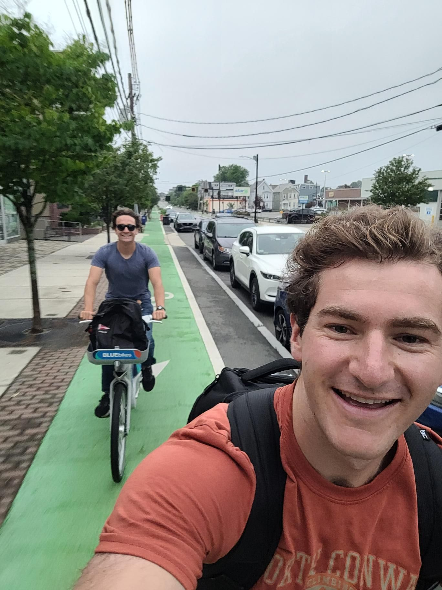

+++
title = "Hangin with the early risers"
description = "Run — 2025-07-09"
date = 2025-07-09
authors = ["Max Katz-Christy"]

[taxonomies]
tags = ["Run"]

[extra]
banner = "banner.jpg"
strava_id = 15055960561
distance_fmt = "8.65 km"
moving_time_fmt = "49m 19s"
elevation_gain_fmt = "21 m"
+++

Bumping into old and new friends on the Charles with Katherine Jankowski 

Plus a look at my home theatre conversion! Projector is back out... Only took like ten tries to figure out how to get it running.

## Stats

| | |
|---|---|
| **Distance** | 8.65 km |
| **Moving time** | 49m 19s |
| **Elapsed time** | 53m 13s |
| **Elevation gain** | 21 m |
| **Average pace** | 5:42 /km |
| **Best pace** | 2:53 /km |
| **Average cadence** | 80 rpm |
| **Calories** | 628 kcal |
| **Achievements** | 10 |
| **Device** | Garmin fēnix 6X |

## Route

{{ strava_map() }}

[View on Strava](https://www.strava.com/activities/15055960561)

## Photos

