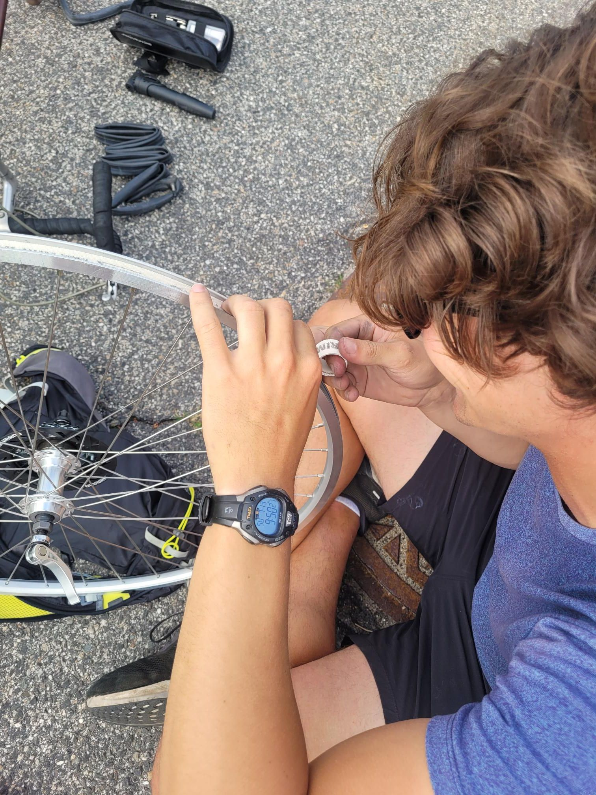

+++
title = "Meeting up with Julius"
description = "Ride — 2025-07-13"
date = 2025-07-13
authors = ["Max Katz-Christy"]

[taxonomies]
tags = ["Ride"]

[extra]
banner = "banner.jpg"
strava_id = 15100348793
distance_fmt = "66.21 km"
moving_time_fmt = "2h 36m 01s"
elevation_gain_fmt = "523 m"
+++

Who has a flat. We fixed the flat. He got another flat. Apparently he thought rim tape was optional.

## Stats

| | |
|---|---|
| **Distance** | 66.21 km |
| **Moving time** | 2h 36m 01s |
| **Elapsed time** | 2h 38m 43s |
| **Elevation gain** | 523 m |
| **Average speed** | 25.5 km/h |
| **Max speed** | 56.7 km/h |
| **Calories** | 997 kcal |
| **Device** | Garmin fēnix 6X |

## Route

{{ strava_map() }}

[View on Strava](https://www.strava.com/activities/15100348793)

## Photos

