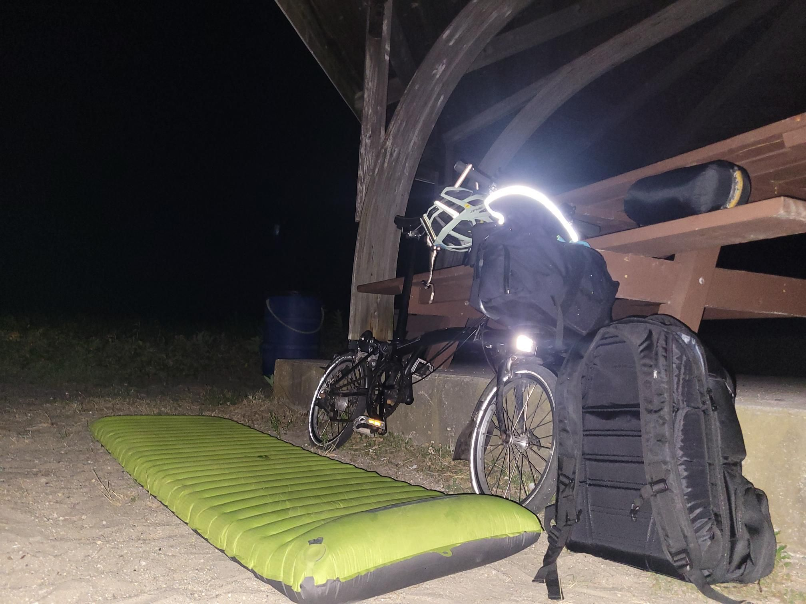

+++
title = "Beach Stealth Camp!"
description = "Ride — 2025-07-23"
date = 2025-07-23
authors = ["Max Katz-Christy"]

[taxonomies]
tags = ["Ride"]

[extra]
banner = "banner.jpg"
strava_id = 15216757086
distance_fmt = "6.99 km"
moving_time_fmt = "28m 47s"
elevation_gain_fmt = "38 m"
+++

South Coast rail doesn't run early enough? No problem. Took the second to last train and found one of my best stealth camps yet. I've got stars, I've got gazebo with benches and picnic tables, I've got ocean, I've got a 20 minute ride to the commuter rail. I even brought a pad and a hammock as options. What a luxurious lifestyle. I just pushed my first commit for my new freelance job from under the gazebo. Am I finally a digital nomad? 

PS: my foot still hurts. Maybe I ran a little toooo far

## Stats

| | |
|---|---|
| **Distance** | 6.99 km |
| **Moving time** | 28m 47s |
| **Elapsed time** | 35m 03s |
| **Elevation gain** | 38 m |
| **Average speed** | 14.6 km/h |
| **Max speed** | 26.0 km/h |
| **Calories** | 198 kcal |
| **Device** | Garmin fēnix 6X |

## Route

{{ strava_map() }}

[View on Strava](https://www.strava.com/activities/15216757086)

## Photos

