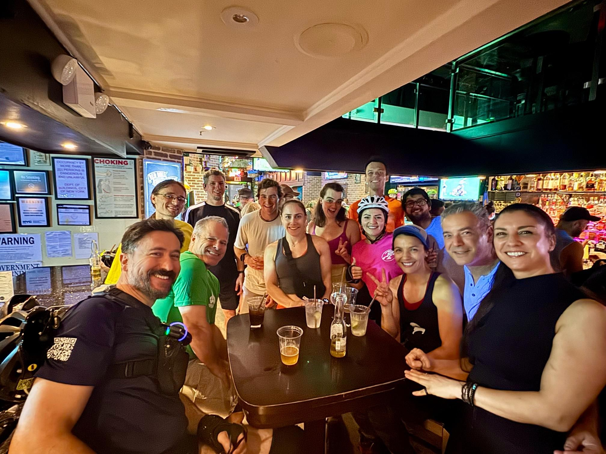

+++
title = "Tgtg NYC roller mania"
description = "InlineSkate — 2025-08-01"
date = 2025-08-01
authors = ["Max Katz-Christy"]

[taxonomies]
tags = ["InlineSkate"]

[extra]
banner = "banner.jpg"
strava_id = 15314613396
distance_fmt = "4.41 km"
moving_time_fmt = "43m 36s"
elevation_gain_fmt = "23 m"
+++

No bagels? No problem. Happy to trade for donuts and ice cream.

Got pizza, croissants, and some heinous pictures of Justin J and Maela Whitcomb

## Stats

| | |
|---|---|
| **Distance** | 4.41 km |
| **Moving time** | 43m 36s |
| **Elapsed time** | 1h 03m 29s |
| **Elevation gain** | 23 m |
| **Average speed** | 6.1 km/h |
| **Max speed** | 30.5 km/h |
| **Calories** | 429 kcal |
| **Device** | Garmin fēnix 6X |

## Route

{{ strava_map() }}

[View on Strava](https://www.strava.com/activities/15314613396)

## Photos

